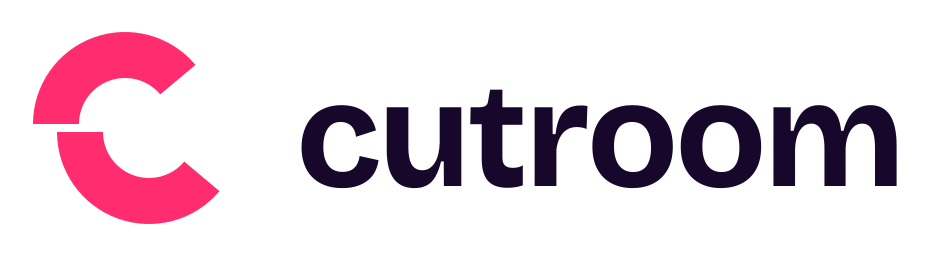
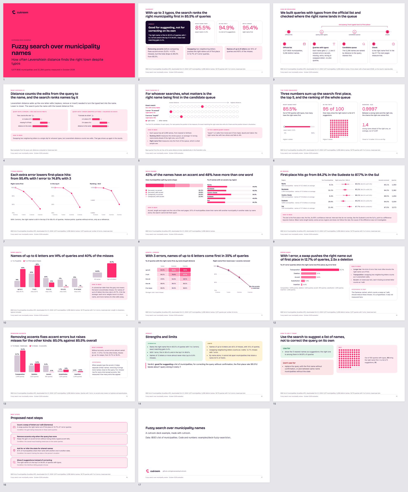
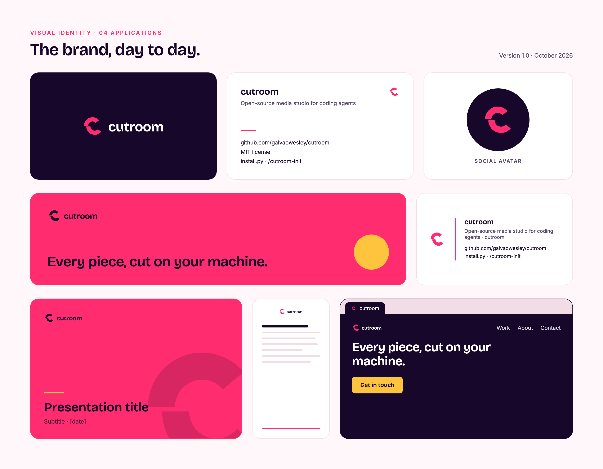
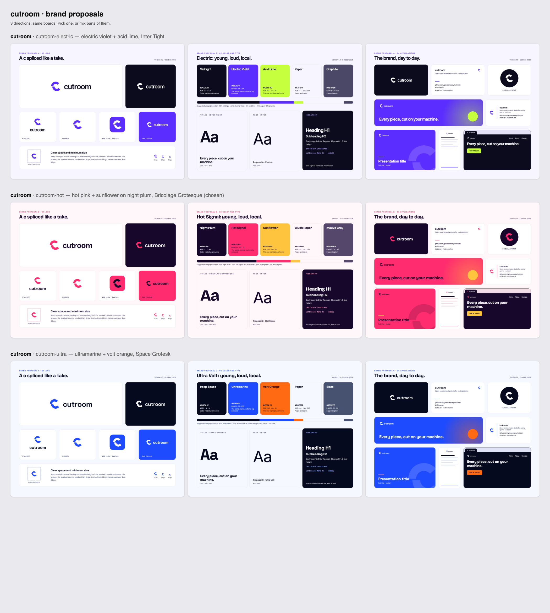
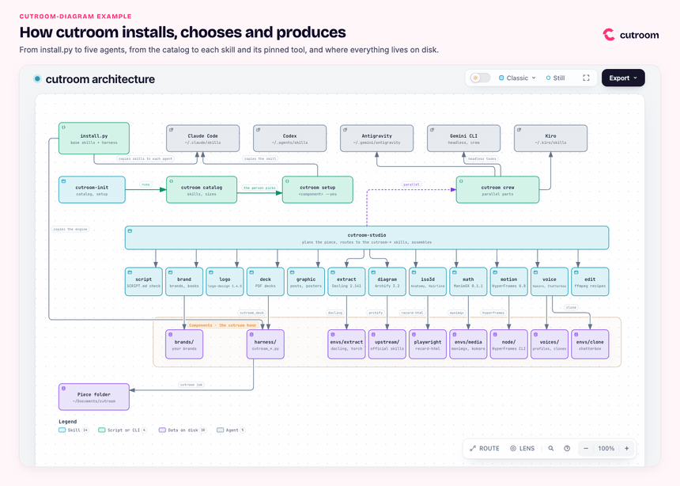
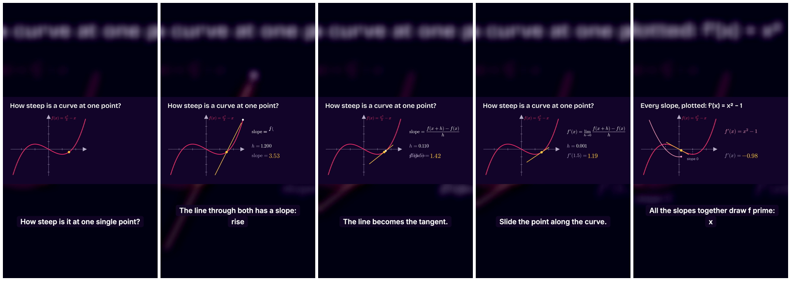
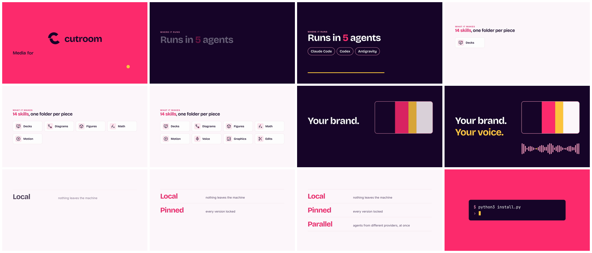

<p align="center"></p>

<p align="center"><b>Every piece, cut on your machine.</b><br>
Media skills for coding agents: decks, diagrams, isometric figures, math and motion videos, narration and voice
cloning, social graphics, post-production and brands. Local, pinned, in your brand.</p>

<p align="center">Claude Code · Codex · Antigravity · Gemini CLI · Kiro &nbsp;·&nbsp; Linux · macOS · Windows &nbsp;·&nbsp; MIT</p>

<p align="center"><a href="examples/motion-intro/"></a></p>

cutroom is a set of [Agent Skills](https://agentskills.io) plus a small harness. You ask your agent for a piece
("a 30-second explainer of the derivative", "a deck from this PDF for leadership", "Instagram posts for the
launch, in our brand") and the skills pick the tool, write the script with sourced facts, produce, check the
result and deliver it in one folder. Installation is opt-in: you see what each component downloads before anything
is installed.

## What it makes

| Skill | What it does | Tool behind it (pinned) | Download | Example |
|---|---|---|---|---|
| `cutroom-init` | catalog, opt-in install, diagnostics, settings | this repo | a few KB | — |
| `cutroom-studio` | the Swiss army knife: plans a piece, routes to the other skills, runs a parallel crew | this repo | a few KB | — |
| `cutroom-script` | standard script: facts with sources, arc, scenes, speech, pronunciation, checked by `cutroom script` | this repo | a few KB | [deck script](examples/deck-fuzzy-search/src/SCRIPT.md) |
| `cutroom-brand` | brands and design systems from your material; brand books; proposals side by side | this repo + Chrome | 0 | [cutroom's own brand](examples/brand-cutroom/), [proposals](examples/brand-proposals/) |
| `cutroom-logo` | logo design from brief to files, tested at 16 px, installed into a brand | [logo-design skill](https://github.com/kaankiziltug/logo-design-skill) 1.4.5 | ~13 MB | [the offset c](examples/brand-cutroom/) |
| `cutroom-deck` | 16:9 PDF decks with the message in the title and charts computed from data | `cutroom_deck` + Chrome | 0 | [fuzzy search](examples/deck-fuzzy-search/) |
| `cutroom-graphic` | social posts, stories, thumbnails, OG images, posters, infographics, certificates | `cutroom render` + Chrome | 0 | templates via `cutroom render new` |
| `cutroom-extract` | PDF, DOCX, PPTX, XLSX, HTML, images to clean Markdown/JSON, with tables and OCR | [Docling](https://github.com/docling-project/docling) 2.141 | ~2.3 GB | [catalog PDF](examples/extract-catalog/) |
| `cutroom-diagram` | interactive architecture, flow, sequence, ERD and timeline diagrams | [Archify](https://github.com/tt-a1i/archify) 3.2 | ~40 MB | [architecture](examples/diagram-architecture/) |
| `cutroom-iso3d` | isometric figures that explain a mechanism, or single-line live icons | [Anatomy](https://github.com/wheresryan22/anatomy) 1.1 + [Hairline](https://github.com/lucasmarkes/hairline) 0.5.1 | ~30 MB | [drawers](examples/iso3d-drawers/), [router](examples/iso3d-router/) |
| `cutroom-math` | scripted math and code videos with narration and captions | [ManimGX](https://manimgx.academa.ai/) 0.1.1 | ~400 MB | [the derivative](examples/math-derivative/) |
| `cutroom-motion` | video and motion graphics from HTML/CSS/GSAP | [HyperFrames](https://github.com/heygen-com/hyperframes) 0.8.183 | ~150 MB | [intro](examples/motion-intro/) |
| `cutroom-voice` | narration in 8 languages, voice profiles and blends; voice cloning with consent, 23 languages | [Kokoro-82M](https://github.com/thewh1teagle/kokoro-onnx), [Chatterbox](https://github.com/resemble-ai/chatterbox) 0.1.7 (optional) | ~740 MB; clone ~4.5 GB | [narration](examples/voice-narration/) |
| `cutroom-edit` | trim, concat, music with ducking, loudness, captions, 9:16 cuts, GIF, compression | `cutroom edit` + ffmpeg | 0 | [cuts](examples/edit-cuts/) |

The tool skills are a thin layer over each tool's **official skill**, cloned at the pinned tag: cutroom installs
the version, applies the conventions (piece folder, language, brand, telemetry off, nothing sent to the cloud) and
chains one tool into the next.

## Examples

Every example was made with the skills themselves, in cutroom's brand. Each folder has the sources in `src/`, the
results in `out/` and a README with the request, the commands and what was checked.

| | |
|---|---|
| <a href="examples/math-derivative/"></a><br>**[The derivative, in 30 s](examples/math-derivative/)** · `cutroom-math` · ManimGX + local narration. The secant turns into the tangent and f′(x) = x² − 1 traces itself. [▶ mp4](examples/math-derivative/out/derivative.mp4) | <a href="examples/deck-fuzzy-search/"></a><br>**[Fuzzy search deck](examples/deck-fuzzy-search/)** · `cutroom-script` + `cutroom-deck` · 17 slides from 22,284 measured queries; [the same deck in the paper brand](examples/deck-fuzzy-search/out/fuzzy-search-municipalities-paper-grid.png). |
| <a href="examples/brand-cutroom/"></a><br>**[cutroom's brand book](examples/brand-cutroom/)** · `cutroom-logo` + `cutroom-brand` · concepts, 16 px tests, four boards in PNG and PDF. | <a href="examples/brand-proposals/"></a><br>**[Brand proposals](examples/brand-proposals/)** · `cutroom brand compare` · three directions side by side, for approval. |
| <a href="examples/diagram-architecture/"></a><br>**[Architecture](examples/diagram-architecture/)** · `cutroom-diagram` · Archify, interactive HTML with focus and routes. | <a href="examples/iso3d-drawers/"></a><br>**[Component drawers](examples/iso3d-drawers/)** · `cutroom-iso3d` · Anatomy: each drawer's depth is a download size, on a log scale. |
| <a href="examples/edit-cuts/"></a><br>**[Cuts and finishing](examples/edit-cuts/)** · `cutroom-edit` · vertical cut with brand captions, music with ducking, audiogram, GIF, email size. | <a href="examples/voice-narration/"></a><br>**[Narration and voices](examples/voice-narration/)** · `cutroom-voice` · English and pt-BR narration, a designed blend, a consented clone. |

## Install

Prerequisites: `git`, Python 3.10+ and [`uv`](https://docs.astral.sh/uv/). Each component asks for the rest (Node 22,
Chrome, ffmpeg) and the catalog says when something is missing.

```bash
git clone https://github.com/galvaowesley/cutroom.git
cd cutroom
python3 install.py                              # detects Claude Code, Codex, Antigravity and Kiro
python3 install.py --agent claude,codex         # or choose the agents
python3 install.py --home ~/Documents/cutroom   # keep the harness, models and voices in a folder you choose
python3 install.py --output ~/Videos/pieces --language pt-BR
```

`./install.sh` (Linux, macOS) and `.\install.ps1` (Windows PowerShell) wrap the same installer. Then, in your agent,
call `cutroom-init`: `/cutroom-init` in Claude Code and Kiro, `$cutroom-init` in Codex, "use the cutroom-init skill"
in Antigravity. It shows the catalog with sizes and installs only what you pick. The same in a terminal:

```bash
. ~/.local/share/cutroom/env.sh          # Windows: . "$env:LOCALAPPDATA\cutroom\env.ps1"
cutroom catalog                          # what exists, what it downloads, how big
cutroom setup diagram iso3d              # plan only
cutroom setup diagram iso3d --yes
cutroom doctor
```

Update: `git pull && python3 install.py`. Remove a component: `cutroom remove <component> --yes`. Remove the skills
from the agents: `python3 install.py --uninstall`.

## Brands

Everything comes out in the active brand. A brand is a folder: `brand.json` (colors, fonts, logos, motion, narration
voice), `DESIGN.md` (how to use them) and `VOICE.md` (how it speaks). Built in: `cutroom` (Hot Signal, the default)
and `paper` (an editorial sample).

```bash
cutroom brand new acme --primary "#0B6E4F"       # complete, contrast-checked palette derived from one color
cutroom brand font acme "Fraunces" --role display
cutroom brand logo acme on_light=logo.svg on_primary=logo-white.svg
cutroom brand check acme                         # schema, files and WCAG contrast
cutroom brand book acme --format html,png,pdf --scale 2
cutroom brand compare acme-a acme-b acme-c       # proposals side by side
cutroom brand use acme
```

Or ask the agent: the `cutroom-brand` skill builds the brand from your logos, screenshots, site, old brand book,
fonts and a few sentences about who you are, proposes directions and waits for your choice.

## Voices

```bash
voice presets --lang pt-BR                      # Kokoro presets, with notes
voice audition --lang en -o audition/           # one sample per preset, to choose by ear
voice add narrator af_heart@0.95 --default      # a profile: preset + speed (+ pronunciation)
voice add host "af_heart*0.6+bm_george*0.4"     # a blend: a new voice without cloning
voice clone ana --ref ana.m4a --speaker "Ana Souza" --consent "recorded consent, 2026-10-23" --lang pt
tts -f speech.txt -o narration.mp3 --voice narrator
```

Cloning runs locally (Chatterbox, watermarked), stores the reference and the consent record together, and is
refused without `--speaker` and `--consent`. Never clone a voice without the speaker's permission.

## Parallel crews across providers

`cutroom crew` hands independent parts of a piece to headless agent CLIs from different providers, each following a
cutroom skill and writing only its own files: one agent orchestrates, others produce.

```bash
cutroom crew runtimes                 # which of claude, codex, agy (Antigravity), gemini, kiro are installed
cutroom crew example -o crew.json     # a batch to start from
cutroom crew run crew.json --dry-run  # commands and the write-partition check
cutroom crew run crew.json --max 4
```

Part of this repository's examples were finished this way, with Claude Code orchestrating and Antigravity producing.

## Where things live

| | Linux and macOS | Windows |
|---|---|---|
| cutroom home (harness, envs, models, brands, voices, config) | `~/.local/share/cutroom` | `%LOCALAPPDATA%\cutroom` |
| any other folder | `python3 install.py --home <dir>` | `py -3 install.py --home <dir>` |
| pieces | `~/Documents/cutroom/<date>-<slug>/{src,work,out}` (`cutroom config output_dir`) | same |
| skills | each agent's skill folder (`~/.claude/skills`, `~/.agents/skills`, `~/.gemini/antigravity/skills`, `~/.kiro/skills`) | same, under the user profile |

```
harness/          cutroom.py (CLI), cutroom_brand.py, cutroom_book.py, cutroom_voice.py, cutroom_script.py,
                  cutroom_render.py, cutroom_edit.py, cutroom_crew.py, cutroom_deck/, record_html.mjs,
                  conventions.md, envs/*/uv.lock, brands/
skills/<name>/    SKILL.md (+ references/), Agent Skills format
examples/         one folder per piece, with src/, out/ and a README
install.py        cross-platform installer (install.sh and install.ps1 wrap it)
```

## Pinned versions and privacy

Python environments are locked by `uv.lock` (`extract`: Docling with CPU torch; `media`: ManimGX and Kokoro; `clone`:
Chatterbox), the HyperFrames CLI by npm version, and every official skill by git tag. Telemetry is off, cloud API keys
are unset in the shell the skills use, and no skill sends content to a cloud service unless you ask. To upgrade a
pin: change it in `harness/cutroom.py` or `harness/envs/<env>/pyproject.toml`, `uv lock`, rerun the component's
example, open a PR.

## Star history

<a href="https://star-history.com/#galvaowesley/cutroom&Date">
  <picture>
    <source media="(prefers-color-scheme: dark)" srcset="https://api.star-history.com/svg?repos=galvaowesley/cutroom&type=Date&theme=dark" />
    <source media="(prefers-color-scheme: light)" srcset="https://api.star-history.com/svg?repos=galvaowesley/cutroom&type=Date" />
    
  </picture>
</a>

## License

MIT for this repository ([LICENSE](LICENSE)). The tools are not bundled: they are downloaded from their official
sources at the pinned version, each under its own license. Docling, Archify, Anatomy, Hairline, ManimGX, Chatterbox
and the logo-design skill are MIT (ManimGX's native wheels bundle x264, GPL-3.0 as a whole); HyperFrames and
kokoro-onnx are Apache-2.0. Model weights have their own licenses. Bundled fonts (Bricolage Grotesque, Inter, Inter
Tight, Fraunces, Instrument Sans, Space Grotesk, JetBrains Mono) are under the SIL Open Font License, with each
license next to the files.

## Contributing

- A skill is `skills/<name>/SKILL.md`, Markdown only; code goes in `harness/`.
- Frontmatter in the [Agent Skills](https://agentskills.io) format: `name`, `description` (with "Use when..." and
  "Usage: ..."), `metadata.version` (SemVer).
- Write agent-neutral steps ("ask with options"); the "Agents" table in `harness/conventions.md` translates them.
- `main` only accepts changes through pull requests. A new or changed skill comes with a new or updated example.
