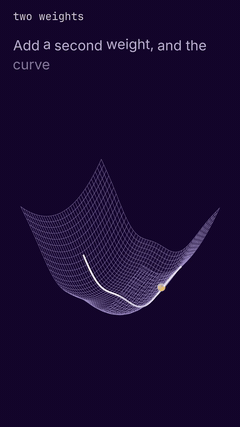
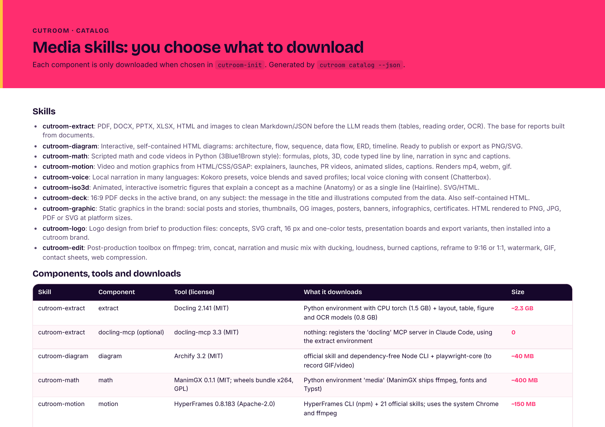

<p align="center">
  <picture>
    <source media="(prefers-color-scheme: dark)" srcset="harness/brands/cutroom/logos/wordmark-deep.svg">
    <source media="(prefers-color-scheme: light)" srcset="harness/brands/cutroom/logos/wordmark.svg">
    
  </picture>
</p>

<p align="center"><b>Every piece, cut on your machine.</b><br>
Media skills for coding agents: decks, diagrams, isometric figures, math and motion videos, narration and voice
cloning, procedural sound effects and audio critique, social graphics, post-production and brands. Local, pinned, in your brand.</p>

<p align="center">Claude Code · Cursor · Codex · Antigravity · Gemini CLI · Kiro &nbsp;·&nbsp; Linux · macOS · Windows &nbsp;·&nbsp; MIT</p>

<p align="center"><b>cutroom in 34 seconds</b> · vertical, with narration and <code>earshot</code> sound effects · made with cutroom-motion, cutroom-voice and cutroom-sound</p>

https://github.com/user-attachments/assets/666b37ae-d702-4c18-baf8-9fb04eb9f3c5

<details>
<summary><b>▶ Em português do Brasil</b></summary>

https://github.com/user-attachments/assets/a41c3389-c294-4043-86da-765efd25c8f0

</details>

<p align="center"><a href="examples/motion-intro/">English (vertical)</a> · <a href="examples/motion-intro-horizontal/">English (horizontal)</a> · <a href="examples/motion-intro-pt/">Português (vertical)</a></p>

cutroom is a set of [Agent Skills](https://agentskills.io) plus a small harness. You ask your agent for a piece
("a 30-second explainer of the derivative", "a deck from this PDF for leadership", "Instagram posts for the
launch, in our brand") and the skills pick the tool, write the script with sourced facts, produce, layer strategic
sound effects when you want them, check the result and deliver it in one folder. Installation is opt-in: you see what
each component downloads before anything is installed.

## What it makes

| Skill | What it does | Tool behind it (pinned) | Download | Example |
|---|---|---|---|---|
| `cutroom-init` | catalog, opt-in install, diagnostics, settings | this repo | a few KB | — |
| `cutroom-studio` | the Swiss army knife: plans a piece, routes to the other skills, runs a parallel crew | this repo | a few KB | — |
| `cutroom-script` | standard script: facts with sources, arc, scenes, speech, pronunciation, checked by `cutroom script` | this repo | a few KB | [deck script](examples/deck-fuzzy-search/src/SCRIPT.md) |
| `cutroom-brand` | brands and design systems from your material; brand books; proposals side by side | this repo + Chrome | 0 | [cutroom's own brand](examples/brand-cutroom/), [proposals](examples/brand-proposals/) |
| `cutroom-logo` | logo design from brief to files, tested at 16 px, installed into a brand | [logo-design-skill](https://github.com/kaankiziltug/logo-design-skill) 1.4.5 | ~13 MB | [the offset c](examples/brand-cutroom/) |
| `cutroom-deck` | 16:9 PDF decks with the message in the title and charts computed from data | `cutroom_deck` + Chrome | 0 | [fuzzy search](examples/deck-fuzzy-search/) |
| `cutroom-graphic` | social posts, stories, thumbnails, OG images, posters, infographics, certificates | `cutroom render` + Chrome | 0 | templates via `cutroom render new` |
| `cutroom-extract` | PDF, DOCX, PPTX, XLSX, HTML, images to clean Markdown/JSON, with tables and OCR | [Docling](https://github.com/docling-project/docling) 2.88.0 | ~2.3 GB | [catalog PDF](examples/extract-catalog/) |
| `cutroom-diagram` | interactive architecture, flow, sequence, ERD and timeline diagrams | [Archify](https://github.com/tt-a1i/archify) 3.2 | ~40 MB | [architecture](examples/diagram-architecture/) |
| `cutroom-iso3d` | isometric figures that explain a mechanism, or single-line live icons | [Anatomy](https://github.com/wheresryan22/anatomy) 1.1 + [Hairline](https://github.com/lucasmarkes/hairline) 0.5.1 | ~30 MB | [drawers](examples/iso3d-drawers/), [router](examples/iso3d-router/) |
| `cutroom-math` | scripted math and code videos with narration, captions, editorial 3-zone layout and optional SFX | [ManimGX](https://github.com/academa-labs/manimgx) 0.1.1 | ~400 MB | [gradient descent](examples/math-gradient-descent/), [derivative](examples/math-derivative/) |
| `cutroom-motion` | video and motion graphics from HTML/CSS/GSAP with optional strategic sound design | [HyperFrames](https://github.com/heygen-com/hyperframes) 0.8.183 | ~150 MB | [intro (vertical)](examples/motion-intro/), [horizontal](examples/motion-intro-horizontal/) |
| `cutroom-voice` | narration in 8 languages, voice profiles and blends; voice cloning with consent, 23 languages | [Kokoro-82M](https://github.com/thewh1teagle/kokoro-onnx), [Chatterbox](https://github.com/resemble-ai/chatterbox) 0.1.7 (optional) | ~740 MB; clone ~4.5 GB | [narration](examples/voice-narration/) |
| `cutroom-sound` | 252 procedural/fitted sound effects, film sound kits, sample-accurate video cue mixing, and audio listening/critique | [earshot](https://github.com/Leonxlnx/earshot) 0.4.0 | ~1.5 GB (with CLAP/AST) | [intro SFX](examples/motion-intro/src/cues.json), [math SFX](examples/math-derivative/src/cues.json) |
| `cutroom-edit` | trim, concat, music with ducking, cue-timed SFX (`edit sfx`), loudness, captions, 9:16 cuts, GIF, compression | `cutroom edit` + ffmpeg | 0 | [cuts](examples/edit-cuts/) |

The tool skills are a thin layer over each tool's **official skill**, cloned at the pinned tag: cutroom installs
the version, applies the conventions (piece folder, language, brand, telemetry off, nothing sent to the cloud) and
chains one tool into the next.

## Examples

Every example was made with the skills themselves, in cutroom's brand. Each folder has the sources in `src/`, the
results in `out/` and a README with the request, the commands and what was checked. Video examples include embedded
narration and strategic `earshot` sound cues. The intro above plays in the page. The other
previews are silent GIFs (GitHub does not render `<video>` tags from a repository file): click one, or its **▶ Watch & listen**
link, to open the `.mp4` with sound.

### The math example: gradient descent, from one weight to two (50 s)

<p align="center">
  <a href="examples/math-gradient-descent/out/gradient-descent.mp4"></a>
</p>
<p align="center">
  <a href="examples/math-gradient-descent/out/gradient-descent.mp4"><strong>▶ Watch &amp; listen (<code>gradient-descent.mp4</code> · 49.8 s · 1080×1920)</strong></a> ·
  <a href="examples/math-gradient-descent/">script, scene and sound cues</a> ·
  <a href="skills/cutroom-math/references/style-and-nuances.md">the style it follows</a>
</p>

`cutroom-math` + `cutroom-sound` · ManimGX 3D + Kokoro + 122 `earshot` cues. A surface is sliced into a curve; zooming in turns the curve into
a line (the gap to its tangent falls from 593 px to 1 px); the update rule `w(t+1) = w(t) − lr · f′(w(t))` is built piece by piece with a label under
each term; three learning rates share one curve (it crawls, it settles, it overshoots); then the curve is swept back into a surface, seen
from above in an isometric view; the camera then orbits the figure, closes in on the gradient arrow and follows the ball down in 12 steps, so nothing stays hidden.

### More examples

| | |
|---|---|
| <a href="examples/motion-intro/out/intro.mp4"></a><br>**[Product intro, in 34 s](examples/motion-intro/)** · `cutroom-motion` + `cutroom-voice` + `cutroom-sound` · HyperFrames + Kokoro `af_heart` + 96 `earshot` cues. The picture follows the voice: natural pauses, overlapping scenes with zoom, whip pan and masks, and a last frame held for 3.5 s. Supports [vertical (9:16)](examples/motion-intro/) and [horizontal (16:9)](examples/motion-intro-horizontal/); also [in Brazilian Portuguese](examples/motion-intro-pt/).<br>[**▶ Watch & listen (`intro.mp4`)**](examples/motion-intro/out/intro.mp4) · [sound sheet](examples/motion-intro/out/sound-sheet.png) | <a href="examples/extract-catalog/"></a><br>**[Document extraction](examples/extract-catalog/)** · `cutroom-extract` · Docling layout analysis and OCR: PDF catalog with split tables extracted back to clean Markdown and structured JSON.<br>[**▶ Extracted Markdown (`catalog.md`)**](examples/extract-catalog/out/catalog.md) · [structured JSON](examples/extract-catalog/out/catalog.json) |
| <a href="examples/edit-cuts/out/intro-final.mp4"></a><br>**[Cuts and finishing](examples/edit-cuts/)** · `cutroom-edit` · scored intro with ducked music bed, 9:16 vertical cut with brand captions, square audiogram, GIF, email size.<br>[**▶ Scored intro (`intro-final.mp4`)**](examples/edit-cuts/out/intro-final.mp4) · [**▶ 9:16 vertical (`derivative-9x16-captions.mp4`)**](examples/edit-cuts/out/derivative-9x16-captions.mp4) · [**▶ 1:1 audiogram (`intro-audiogram.mp4`)**](examples/edit-cuts/out/intro-audiogram.mp4) | <a href="examples/voice-narration/"></a><br>**[Narration and voices](examples/voice-narration/)** · `cutroom-voice` · English and pt-BR narration, a designed blend, and a consented local voice clone.<br>[**▶ Listen: EN (`intro-en.mp3`)**](examples/voice-narration/out/intro-en.mp3) · [**▶ Listen: pt-BR (`intro-pt-br.mp3`)**](examples/voice-narration/out/intro-pt-br.mp3) · [**▶ Listen: blend (`blend-host.mp3`)**](examples/voice-narration/out/blend-host.mp3) |
| <a href="examples/deck-fuzzy-search/"></a><br>**[Fuzzy search deck](examples/deck-fuzzy-search/)** · `cutroom-script` + `cutroom-deck` · 17 slides from 22,284 measured queries; [the same deck in the paper brand](examples/deck-fuzzy-search/out/fuzzy-search-municipalities-paper-grid.png). | <a href="examples/brand-cutroom/"></a><br>**[cutroom's brand book](examples/brand-cutroom/)** · `cutroom-logo` + `cutroom-brand` · concepts, 16 px tests, four boards in PNG and PDF. [Brand proposals side by side](examples/brand-proposals/). |
| <a href="examples/diagram-architecture/"></a><br>**[Architecture](examples/diagram-architecture/)** · `cutroom-diagram` · Archify, interactive HTML with focus and routes. | <a href="examples/iso3d-drawers/"></a><br>**[Component drawers](examples/iso3d-drawers/)** · `cutroom-iso3d` · Anatomy: each drawer's depth is a download size, on a log scale. |

## Install

### Fastest way — hand the repository link to your coding agent

Paste this into **Claude Code**, **Cursor**, **Codex**, **Antigravity**, **Gemini CLI**, or **Kiro**:

```text
Install and configure https://github.com/galvaowesley/cutroom on my machine, then run cutroom-init.
```

Your coding agent will clone the repository, run `python3 install.py`, detect your installed agents, and open the
opt-in `cutroom-init` catalog so you can choose which components to download.

### Manual CLI setup

Prerequisites: `git`, Python 3.10+ and [`uv`](https://docs.astral.sh/uv/). Each component asks for the rest (Node 22,
Chrome, ffmpeg) and the catalog says when something is missing.

```bash
git clone https://github.com/galvaowesley/cutroom.git
cd cutroom
python3 install.py                              # detects Claude Code, Cursor, Codex, Antigravity and Kiro
python3 install.py --agent claude,cursor,codex  # or choose the agents explicitly
python3 install.py --home ~/Documents/cutroom   # keep the harness, models and voices in a folder you choose
python3 install.py --output ~/Videos/pieces --language pt-BR
```

`./install.sh` (Linux, macOS) and `.\install.ps1` (Windows PowerShell) wrap the same installer. Then, in your agent,
call `cutroom-init`: `/cutroom-init` in Claude Code, Cursor and Kiro, `$cutroom-init` in Codex, or "use the
cutroom-init skill" in Antigravity and Gemini CLI. In a terminal:

```bash
. ~/.local/share/cutroom/env.sh          # Windows: . "$env:LOCALAPPDATA\cutroom\env.ps1"
cutroom catalog                          # what exists, what it downloads, how big
cutroom setup math motion sound          # plan only
cutroom setup math motion sound --yes
cutroom doctor
```

Update: `git pull && python3 install.py`. Remove a component: `cutroom remove <component> --yes`. Remove the skills
from the agents: `python3 install.py --uninstall`.

To listen for updates in the upstream skill/tool repositories (`earshot`, `hyperframes`, `manimgx`, `archify`,
`anatomy`, `hairline`, `logo`, `docling`, etc.), use `cutroom updates`—with manual approval (`ask`, default) or
pre-approved automatic updates (`auto`):

```bash
cutroom updates check                                 # check all upstream skill/tool repos in parallel
cutroom updates apply earshot --yes                   # manually approve and apply a local update
cutroom updates policy --mode auto                    # pre-approve automatic updates for all upstream repos
cutroom updates policy --mode ask --approve earshot   # auto-update earshot, require manual approval for the rest
cutroom updates watch --interval 60 --apply-auto      # background listener (or --once on session start)
```

## Brands

Everything comes out in the active brand. A brand is a folder: `brand.json` (colors, fonts, logos, motion, narration
voice), `DESIGN.md` (how to use them) and `VOICE.md` (how it speaks). Built in: `cutroom` (Hot Signal, the default)
and `paper` (an editorial sample).

```bash
cutroom brand new acme --primary "#0B6E4F"       # complete, contrast-checked palette derived from one color
cutroom brand font acme "Fraunces" --role display
cutroom brand logo acme on_light=logo.svg on_primary=logo-white.svg
cutroom brand check acme                         # schema, files and WCAG contrast
cutroom brand book acme --format html,png,pdf --scale 2
cutroom brand compare acme-a acme-b acme-c       # proposals side by side
cutroom brand use acme
```

Or ask the agent: the `cutroom-brand` skill builds the brand from your logos, screenshots, site, old brand book,
fonts and a few sentences about who you are, proposes directions and waits for your choice.

## Voices

```bash
voice presets --lang pt-BR                      # Kokoro presets, with notes
voice audition --lang en -o audition/           # one sample per preset, to choose by ear
voice add narrator af_heart@0.95 --default      # a profile: preset + speed (+ pronunciation)
voice add host "af_heart*0.6+bm_george*0.4"     # a blend: a new voice without cloning
voice clone ana --ref ana.m4a --speaker "Ana Souza" --consent "recorded consent, 2026-10-23" --lang pt
tts -f speech.txt -o narration.mp3 --voice narrator
```

Cloning runs locally (Chatterbox, watermarked), stores the reference and the consent record together, and is
refused without `--speaker` and `--consent`. Never clone a voice without the speaker's permission.

## Sound effects and audio listening (`cutroom-sound`)

Powered by [`Leonxlnx/earshot`](https://github.com/Leonxlnx/earshot), `cutroom-sound` gives agents both **ears** (to
listen to, measure, and critique existing audio or video) and **hands** (252 procedural and acoustically fitted sound
effects, 8 film sound kits, and sample-accurate cue mixing). When producing motion or math videos, the skills ask
whether you want strategic sound effects (`subtle`, `expressive`, or `none`) and align each cue's physical `onset_s`,
`peak_s`, or `end_s` to the visual frame:

```bash
earshot sfx list                                         # 252 sounds across ticks, UI, foley, whooshes, chimes, chords
earshot sfx marker.chalk -o chalk.wav --duration 0.6     # render a single procedural / fitted sound
earshot kit render chalkboard -o kit/                    # render a cohesive film sound kit
cutroom edit sfx video.mp4 --cues cues.json -o out.mp4   # sample-accurate cue placement + mix under narration
earshot sheet out.mp4 --cues cues.json -o sound-sheet.png # spectrogram + waveform + LUFS + cue sync audit
earshot critique out.mp4 --profile shortform             # loudness, mud, harshness, stop-downs and sync report
```

## Parallel crews across providers

`cutroom crew` hands independent parts of a piece to headless agent CLIs from different providers, each following a
cutroom skill and writing only its own files: one agent orchestrates, others produce.

```bash
cutroom crew runtimes                 # which of claude, cursor, codex, agy (Antigravity), gemini, kiro are installed
cutroom crew example -o crew.json     # a batch to start from
cutroom crew run crew.json --dry-run  # commands and the write-partition check
cutroom crew run crew.json --max 4
```

Part of this repository's examples were finished this way, with Claude Code orchestrating and Antigravity producing.

## Where things live

| | Linux and macOS | Windows |
|---|---|---|
| cutroom home (harness, envs, models, brands, voices, config) | `~/.local/share/cutroom` | `%LOCALAPPDATA%\cutroom` |
| any other folder | `python3 install.py --home <dir>` | `py -3 install.py --home <dir>` |
| pieces | `~/Documents/cutroom/<date>-<slug>/{src,work,out}` (`cutroom config output_dir`) | same |
| skills | each agent's skill folder (`~/.claude/skills`, `~/.cursor/skills`, `~/.agents/skills`, `~/.gemini/antigravity/skills`, `~/.kiro/skills`) | same, under the user profile |

```
harness/          cutroom.py (CLI), cutroom_brand.py, cutroom_book.py, cutroom_voice.py, cutroom_script.py,
                  cutroom_render.py, cutroom_edit.py, cutroom_crew.py, cutroom_deck/, record_html.mjs,
                  conventions.md, envs/*/uv.lock, brands/
skills/<name>/    SKILL.md (+ references/), Agent Skills format
examples/         one folder per piece, with src/, out/ and a README
install.py        cross-platform installer (install.sh and install.ps1 wrap it)
```

## Pinned versions and privacy

Python environments are locked by `uv.lock` (`extract`: Docling with CPU torch; `media`: ManimGX and Kokoro; `clone`:
Chatterbox; `sound`: earshot with CLAP and AudioSet AST), the HyperFrames CLI by npm version, and every official skill
by git tag. Telemetry is off, cloud API keys are unset in the shell the skills use, and no skill sends content to a
cloud service unless you ask. You can keep every version strictly pinned, or use `cutroom updates` to listen to the
upstream repositories and apply updates with manual approval (`ask`, default) or pre-approved automatic updates
(`cutroom updates policy --mode auto` / `--approve <source>`). To upgrade a default repository pin: change it in
`harness/cutroom.py` or `harness/envs/<env>/pyproject.toml`, `uv lock`, rerun the component's example, open a PR.

## Credits and third-party repositories

cutroom stands on the shoulders of open-source tools, official agent skills, acoustic/speech models, and open
typefaces. Each upstream repository is cloned or locked at a pinned version when you opt in via `cutroom setup`:

| Upstream project / skill | Author / Maintainer | Used by | Role in cutroom | License |
|---|---|---|---|---|
| **[earshot](https://github.com/Leonxlnx/earshot)** (`v0.4.0`, `earshot` & `real-sound` skills) | [Leon Lin (`@Leonxlnx`)](https://github.com/Leonxlnx) | `cutroom-sound`, `cutroom-motion`, `cutroom-math`, `cutroom-edit` | 252-sound procedural & acoustically fitted bank, film sound kits, sample-accurate cue synchronization, audio contact sheets (`earshot sheet`), and CLAP/AST listening & critique | MIT |
| **[ManimGX](https://github.com/academa-labs/manimgx)** (`v0.1.1`, `manimgx` skill) | [Academa Labs](https://manimgx.academa.ai/) (built on Grant Sanderson's [Manim](https://github.com/3b1b/manim) & [Manim Community](https://github.com/ManimCommunity/manim)) | `cutroom-math` | Mathematical and code animation engine with scene-level narration synchronization, auto-generated `.srt` captions, and storyboard sheets | MIT (wheels bundle x264, GPL-3.0) |
| **[HyperFrames](https://github.com/heygen-com/hyperframes)** (`v0.8.183`, `hyperframes` skill) | [HeyGen](https://github.com/heygen-com) | `cutroom-motion` | Deterministic frame-by-frame HTML/CSS/GSAP video rendering, WCAG contrast & layout auditing (`hyperframes check`), and timeline linting | Apache-2.0 |
| **[Docling](https://github.com/docling-project/docling)** (`v2.88.0`) & **[docling-mcp](https://github.com/docling-project/docling-mcp)** (`v1.5.0`) | [Docling Project / IBM Research / LF AI & Data](https://github.com/docling-project) | `cutroom-extract` | Local PDF, DOCX, PPTX, XLSX, HTML, and image layout analysis, table reconstruction, and OCR to clean Markdown and JSON | MIT |
| **[Archify](https://github.com/tt-a1i/archify)** (`v3.2`, `archify` skill) | [`@tt-a1i`](https://github.com/tt-a1i) | `cutroom-diagram` | Self-contained interactive HTML architecture, flow, sequence, ERD, and timeline diagrams | MIT |
| **[Anatomy](https://github.com/wheresryan22/anatomy)** (`v1.1`, `anatomy` skill) | [`@wheresryan22`](https://github.com/wheresryan22) | `cutroom-iso3d` | Exploded isometric 3D mechanism diagrams with interactive callouts and layered SVG geometry | MIT |
| **[Hairline](https://github.com/lucasmarkes/hairline)** (`v0.5.1`, `hairline` skill) | [Lucas Markes (`@lucasmarkes`)](https://github.com/lucasmarkes) | `cutroom-iso3d` | Single-line animated SVG icons and technical micro-illustrations | MIT |
| **[logo-design-skill](https://github.com/kaankiziltug/logo-design-skill)** (`v1.4.5`) | [Kaan Kızıltuğ (`@kaankiziltug`)](https://github.com/kaankiziltug) | `cutroom-logo` | Vector logo construction principles, 16 px legibility testing, monochrome checks, and presentation boards | MIT |
| **[Kokoro-82M](https://huggingface.co/hexgrad/Kokoro-82M)** & **[kokoro-onnx](https://github.com/thewh1teagle/kokoro-onnx)** (`v0.5.0`) | [`@hexgrad`](https://huggingface.co/hexgrad) & [`@thewh1teagle`](https://github.com/thewh1teagle) | `cutroom-voice` | Local neural text-to-speech across 8 languages, voice blending, and word-level timing | Apache-2.0 |
| **[Chatterbox](https://github.com/resemble-ai/chatterbox)** (`v0.1.7`) | [Resemble AI](https://github.com/resemble-ai) | `cutroom-voice` | Local zero-shot voice cloning across 23 languages with PerTh perceptual watermarking | MIT |
| **[LAION CLAP](https://huggingface.co/laion/larger_clap_general)** & **[MIT AudioSet AST](https://huggingface.co/MIT/ast-finetuned-audioset-10-10-0.4593)** | LAION & MIT CSAIL | `cutroom-sound` | Zero-shot text-to-audio similarity scoring (`earshot match`, `find`, `rank`, `realness`) and 527-class acoustic event tagging (`earshot describe`, `timeline`, `sheet`) | MIT / Apache-2.0 / BSD-3 |
| **Open Font License Typefaces** | [Bricolage Grotesque](https://github.com/ateliertriay/bricolage) (Mathieu Triay), [Inter](https://github.com/rsms/inter) (Rasmus Andersson), [Fraunces](https://github.com/undercasetype/Fraunces) (Undercase Type), [Instrument Sans](https://github.com/instrument/instrument-sans), [Space Grotesk](https://github.com/floriankarsten/space-grotesk) (Florian Karsten), [JetBrains Mono](https://github.com/JetBrains/JetBrainsMono) | `cutroom-brand`, all visual skills | Bundled offline in `harness/brands/*/fonts/` with their OFL-1.1 texts so every render is deterministic offline | SIL OFL 1.1 |

## Star history

<a href="https://star-history.com/#galvaowesley/cutroom&Date">
  <picture>
    <source media="(prefers-color-scheme: dark)" srcset="https://api.star-history.com/svg?repos=galvaowesley/cutroom&type=Date&theme=dark" />
    <source media="(prefers-color-scheme: light)" srcset="https://api.star-history.com/svg?repos=galvaowesley/cutroom&type=Date" />
    
  </picture>
</a>

## License

MIT for this repository ([LICENSE](LICENSE)). The tools are not bundled: they are downloaded from their official
sources at the pinned version, each under its own license (see [Credits and third-party repositories](#credits-and-third-party-repositories)).

## Contributing

- A skill is `skills/<name>/SKILL.md`, Markdown only; code goes in `harness/`.
- Frontmatter in the [Agent Skills](https://agentskills.io) format: `name`, `description` (with "Use when..." and
  "Usage: ..."), `metadata.version` (SemVer).
- Write agent-neutral steps ("ask with options"); the "Agents" table in `harness/conventions.md` translates them.
- `main` only accepts changes through pull requests. A new or changed skill comes with a new or updated example.
