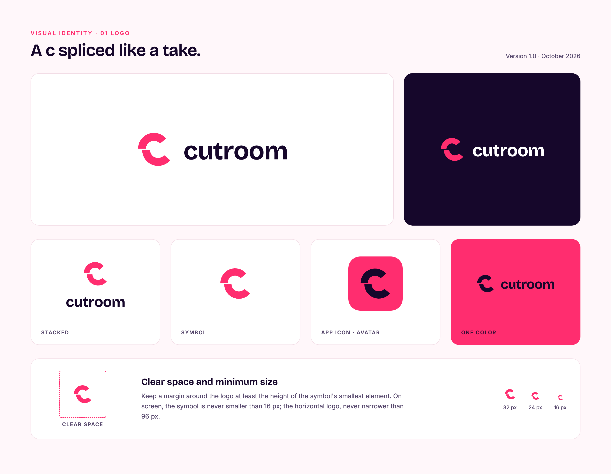

# Example: cutroom brand system and logo (cutroom-brand + cutroom-logo)

**Request:** "Design the visual identity and logo for cutroom: concept discovery across mark types, vector geometry generation for the spliced 'c' symbol and wordmark lockups, multi-scale and reversed testing, and render the complete 4-board brand book in PDF and PNG."

<p align="center"></p>

[`out/book/cutroom-brand-book.pdf`](out/book/cutroom-brand-book.pdf) (4 boards, vector PDF, 688 KB) · [`out/book/01-logo.png`](out/book/01-logo.png) (325 KB) · [`out/book/02-color.png`](out/book/02-color.png) (357 KB) · [`out/book/03-icons.png`](out/book/03-icons.png) (375 KB) · [`out/book/04-applications.png`](out/book/04-applications.png) (423 KB) · [`out/logo/test-sheet.png`](out/logo/test-sheet.png) (283 KB) · source in [`src/logo/`](src/logo)

| File | Description |
|---|---|
| [`out/book/cutroom-brand-book.pdf`](out/book/cutroom-brand-book.pdf) | Deliverable: complete 4-board brand book rendered as vector PDF at 2× scale (688 KB) |
| [`out/book/01-logo.png`](out/book/01-logo.png) | Board 1: logo construction, clear space, symbol geometry, and lockup hierarchy (325 KB) |
| [`out/book/02-color.png`](out/book/02-color.png) | Board 2: color palette tokens, contrast ratios, and typography pairings (357 KB) |
| [`out/book/03-icons.png`](out/book/03-icons.png) | Board 3: 12-icon brand suite on a 24×24 grid with 1.75 px stroke and hot cue dots (375 KB) |
| [`out/book/04-applications.png`](out/book/04-applications.png) | Board 4: day-to-day media applications (deck cover, video endplate, cards, posts) (423 KB) |
| [`out/logo/concepts-round-1.png`](out/logo/concepts-round-1.png) | Concept sheet comparing 3 candidate directions (Splice A, Offset c B, Room C) (188 KB) |
| [`out/logo/concepts-round-2.png`](out/logo/concepts-round-2.png) | Refinement sheet evaluating detailed evolutions A2 and B2 (199 KB) |
| [`out/logo/test-sheet.png`](out/logo/test-sheet.png) | Technical stress test: 16 px favicon, dark/light contrast, reversed backgrounds (283 KB) |
| [`src/logo/build.py`](src/logo/build.py) | Parametric SVG script outlining font glyphs and constructing initial geometry (1.6 KB) |
| [`src/logo/build2.py`](src/logo/build2.py) | Second-round script generating precise ring segment paths for the offset symbol (1.4 KB) |
| [`src/logo/lockups.py`](src/logo/lockups.py) | Lockup builder: outputs symbol, wordmark, mono, stacked, and app-icon SVGs (1.8 KB) |
| [`src/logo/*.svg`](src/logo) | Raw SVG exports for concepts a, a2, b, b2, and c |

## Design concept and logo construction

1. **Concept Exploration:**
   - **Concept A (Splice):** two video clips on a timeline cut by a vertical playhead slit.
   - **Concept B (Offset c - Chosen):** the letter 'c' severed at its horizontal midpoint with the lower half slid rightward, evoking a spliced film take.
   - **Concept C (Room):** camera viewfinder crop corners framing a central subject.

2. **Geometric Construction (Symbol B2):**
   - Constructed as two heavy ring segments with outer radius $R = 92$ and inner radius $r = 46$ (stroke thickness 46):
     - Top arc: centered at $(122, 128)$, spanning angles $40^\circ$ to $180^\circ$.
     - Bottom arc: shifted right and down to $(146, 136)$, spanning angles $180^\circ$ to $320^\circ$.
   - The offset break visually represents the editorial cut while preserving letterform legibility.

3. **Typographic Lockup:**
   - Wordmark "cutroom" set in Bricolage Grotesque 700 with tightened letter tracking ($-3$).
   - Standard export suite generated by [`src/logo/lockups.py`](src/logo/lockups.py):
     - Horizontal wordmarks: `wordmark.svg` (primary on light), `wordmark-light.svg` (white on dark), `wordmark-deep.svg` (on night plum), `mono.svg` (single-tone).
     - Isolated symbols: `symbol.svg`, `symbol-light.svg`, `symbol-deep.svg`.
     - Layout variants: `stacked.svg` (vertical stack) and `app-icon.svg` (256×256 squircle).

## Commands

```bash
. ~/.local/share/cutroom/env.sh
cd src/logo

# 1. Generate symbol geometry and brand lockup SVGs
python3 build.py ~/.local/share/cutroom/harness/brands/cutroom/fonts/BricolageGrotesque-700.ttf
python3 build2.py
python3 lockups.py ~/.local/share/cutroom/harness

# 2. Run brand validation suite
cutroom brand check cutroom

# 3. Render brand book in PDF and PNG at 2x resolution
cutroom brand book cutroom -o ../../out/book/cutroom-brand-book.pdf --format pdf,png --scale 2
```

## What to verify

- `cutroom brand check cutroom` exits with code 0:
  - All color tokens pass WCAG AA contrast rules (minimum 4.5:1 for body text, 3.0:1 for large display titles).
  - All bundled fonts (Bricolage Grotesque, Inter, JetBrains Mono NL) have matching font files and SIL Open Font Licenses (OFL).
  - All declared SVG logos are valid XML and render cleanly without missing glyphs.
- Technical stress testing in [`out/logo/test-sheet.png`](out/logo/test-sheet.png):
  - Mark remains recognizable at 16×16 px favicon scale.
  - Consistent optical weight across positive (`#16072B` on white) and negative (`#FFFFFF` on deep) lockups.
- Brand book boards: 4 boards in [`out/book/`](out/book) verify logo construction, typography, 12 skill icons, and mockup applications.

## How to open

```bash
# macOS
open out/book/cutroom-brand-book.pdf
open out/book/01-logo.png

# Linux
xdg-open out/book/cutroom-brand-book.pdf
```

## Brand specifications

- **Colors:**
  - Primary: Hot Signal `#FF2D6F` (22% share: covers, marks, primary buttons)
  - Deep: Night Plum `#16072B` (38% share: code blocks, verdicts, dark video backgrounds)
  - Accent: Sunflower `#FFC43D` (6% share: single focal highlight per frame)
  - Surface: Blush Paper `#FFF7FA` (28% share: page backgrounds and cards)
  - Text: Night Plum `#16072B` (on light), White `#FFFFFF` (on deep)
- **Typography:**
  - Display: Bricolage Grotesque (weights 300, 500, 600, 700, 800)
  - Text: Inter (weights 400, 600)
  - Monospace: JetBrains Mono NL (weights 400, 700)
- **Tagline:** "Every piece, cut on your machine."

## Limits

- The offset break in symbol B2 is tuned for horizontal and squircle applications; in circular avatar crops, the mark must be centered optically rather than geometrically.
