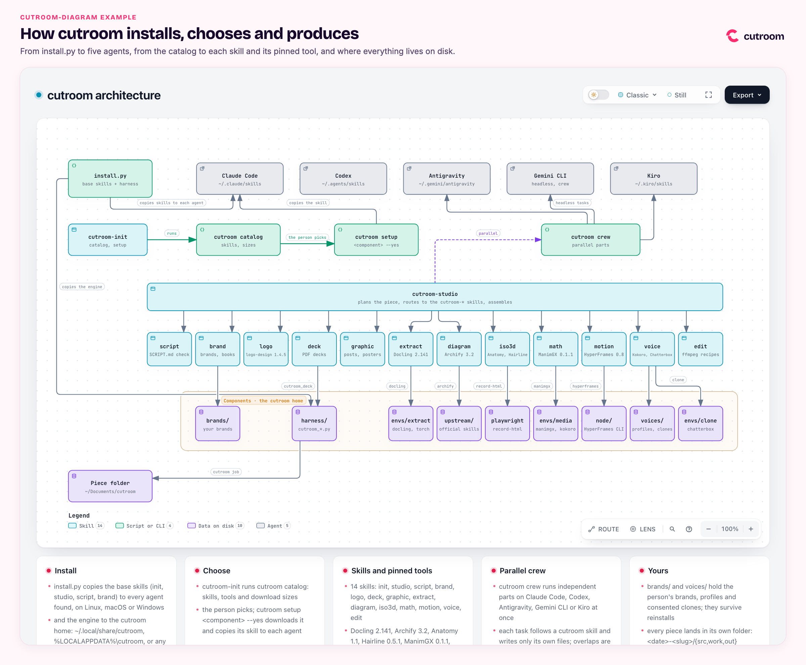

# Example: cutroom architecture diagram (cutroom-diagram / Archify 3.2)

**Request:** "Interactive architecture diagram explaining how cutroom installs, routes and produces media across 5 coding agents and 14 skills, with physical folder structure, pinned tools and brand tokens. Deliver as self-contained HTML with brand framing."

<p align="center"></p>

[`out/architecture.html`](out/architecture.html) (interactive Archify 3.2 diagram, 1.18 MB) · [`out/architecture.png`](out/architecture.png) (brand frame preview, 433 KB) · [`out/architecture.gif`](out/architecture.gif) (animated walkthrough, 503 KB) · [`out/architecture.delivery.json`](out/architecture.delivery.json) (receipt, 28 KB) · source in [`src/`](src)

| File | Description |
|---|---|
| [`out/architecture.html`](out/architecture.html) | Deliverable: interactive, self-contained Archify 3.2 architecture diagram (1.18 MB) |
| [`out/architecture.delivery.json`](out/architecture.delivery.json) | Archify delivery receipt confirming automated validation and cryptographic hashes (28 KB) |
| [`out/architecture.png`](out/architecture.png) | High-resolution static capture of the diagram inside the cutroom brand frame (433 KB) |
| [`out/architecture.gif`](out/architecture.gif) | 8-second animated loop demonstrating diagram navigation and frame layout (503 KB) |
| [`src/candidate.json`](src/candidate.json) | Source diagram specification: 738 lines defining nodes, groups, edges, and coordinates (28.7 KB) |
| [`src/frame.html`](src/frame.html) | Brand frame container with header typography, wordmark logo, and embedded iframe (1.4 KB) |
| [`src/brand/`](src/brand) | Local copy of brand tokens.css, fonts.css, fonts/, and logos/ for offline frame rendering |

## Concept and architecture model

The diagram maps the full lifecycle and physical disk topology of the cutroom system across four distinct layers:

1. **Coding Agents (External):**
   - Claude Code (`~/.claude/skills`)
   - Codex (`~/.agents/skills`)
   - Antigravity (`~/.gemini/antigravity/skills`)
   - Gemini CLI (`~/.gemini/skills`)
   - Kiro (`~/.kiro/skills`)

2. **Entry Points and Harness:**
   - `install.py`: base installer with flags `--home` and `--agent`.
   - `cutroom` CLI router (`catalog`, `doctor`, `job`, `config`, `crew`, `brand`, `voice`, `edit`, `render`).
   - Cutroom home folder (`~/.local/share/cutroom`): contains `harness/`, `bin/`, `brands/`, `voices/`, `envs/`, `models/`, and `upstream/`.

3. **Media Skills Suite (14 Skills):**
   - Orchestration: `cutroom-init`, `cutroom-studio`, `cutroom-script`.
   - Text & Presentation: `cutroom-extract`, `cutroom-deck`.
   - Visuals & 3D: `cutroom-diagram`, `cutroom-iso3d`, `cutroom-graphic`.
   - Audio & Video: `cutroom-math`, `cutroom-motion`, `cutroom-voice`, `cutroom-edit`.
   - Identity: `cutroom-brand`, `cutroom-logo`.

4. **Underlying Tools and Pinned Runtimes:**
   - Specialized engines: Docling, Archify, Anatomy, Hairline, ManimGX, HyperFrames, Kokoro, Chatterbox, ffmpeg, and headless Chrome.

## Commands

```bash
. ~/.local/share/cutroom/env.sh
cd src

# 1. Finalize and validate Archify diagram specification
archify finalize architecture candidate.json ../out/architecture.html --quality showcase --json

# 2. Record animated GIF preview of the brand frame
record-html frame.html ../out/architecture.gif --seconds 8 --size 1200x800 --fps 12

# 3. Capture high-resolution PNG screenshot
google-chrome --headless=new --window-size=1200,800 --screenshot=../out/architecture.png frame.html
```

## What to verify

- `archify finalize` exited 0.
- `out/architecture.delivery.json` verification:
  - Status: `"current"`
  - Type: `"architecture"`
  - Specification SHA-256: `86f0176eab5b78d028db73c211b689b22d09d7533ff35e2c36f5633ddea60ea0`
  - Artifact SHA-256: `e4cebc8dfa891241634332a37a4b89ae16fd7cc10aa08c0058a91a51622b2229`
- Interactive features in `out/architecture.html`:
  - Route tracing on edge hover.
  - Component search bar filtering nodes by name and tag.
  - Light and dark display mode toggling.
  - Pan and zoom navigation without rendering artifacts.
- Self-contained packaging: the HTML runs completely offline without network requests for scripts or styles.

## How to open

```bash
# macOS
open out/architecture.html
open src/frame.html

# Linux
xdg-open out/architecture.html
```

## Brand applied

- **Light theme alignment:** framed preview loads `architecture.html?theme=light` inside the branded frame.
- **Brand frame (`src/frame.html`):**
  - Background: Blush Paper (`--surface` `#FFF7FA`).
  - Eyebrow: Hot Signal (`--primary` `#FF2D6F`) in Bricolage Grotesque 700 uppercase.
  - Headline: Night Plum (`--text` `#16072B`) in Bricolage Grotesque 700.
  - Logo: official wordmark (`src/brand/logos/wordmark.svg`).
  - Framing: 20 px rounded border with subtle shadow and border `#F2DDE6`.

## Limits

- Archify adheres to semantic component color coding (frontend, backend, external, database) rather than arbitrary brand palettes.
- Secondary tags on nodes (such as CLI flags and file paths) appear only when zoomed in or focused.
