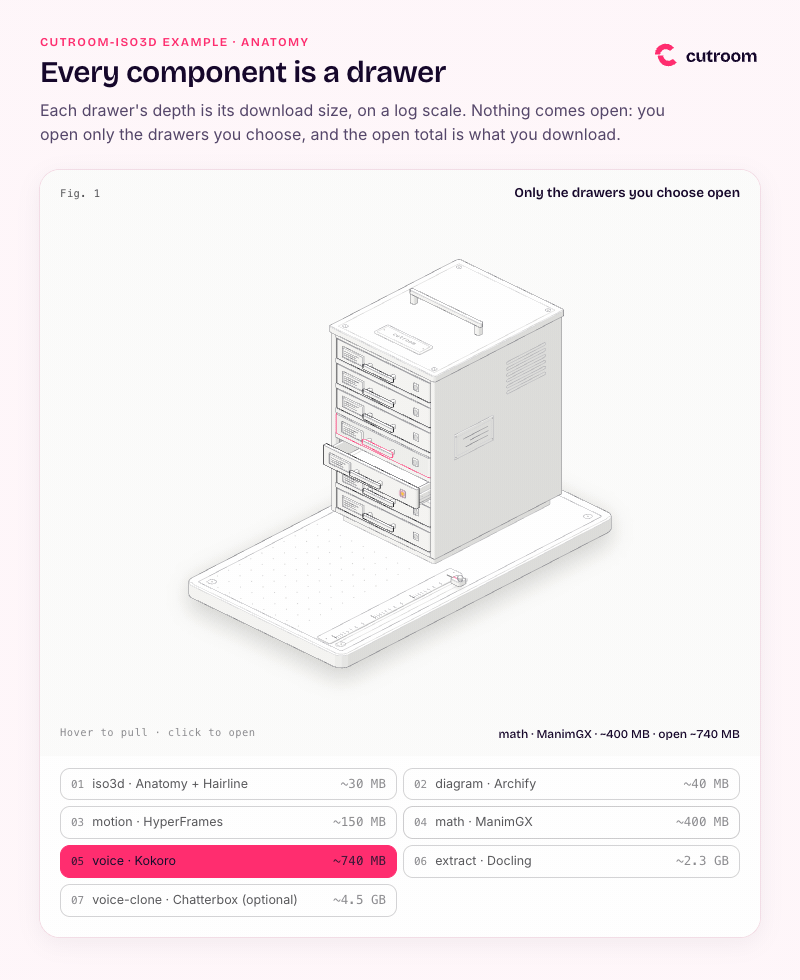

# Example: component drawers (cutroom-iso3d / Anatomy 1.1)

**Request:** "Physical explainer of cutroom's opt-in installation as a steel drawer cabinet on a workbench: 7 drawers representing components, where drawer depth is proportional to download size on a logarithmic scale. Include live ruler, LED status lights, interactive tour, and brand framing."

<p align="center"></p>

[`out/drawers.html`](out/drawers.html) (283 KB, self-contained Anatomy 1.1 interactive HTML) · [`out/drawers.png`](out/drawers.png) (507 KB, 2x frame preview with 4 drawers open) · [`out/drawers.gif`](out/drawers.gif) (546 KB, 8 s, 800 px, 12 fps preview) · source in [`src/`](src)

| File | Description |
|---|---|
| [`out/drawers.html`](out/drawers.html) | Deliverable: self-contained single-file HTML figure (inlined 3D kit, subset fonts, and script), 283 KB |
| [`out/drawers.png`](out/drawers.png) | 2× resolution capture in brand frame with 4 drawers open (~3.6 GB total) and cursor on voice-clone, 507 KB |
| [`out/drawers.gif`](out/drawers.gif) | 8-second animated recording at 12 fps demonstrating hover interactions and live readout updates, 546 KB |
| [`src/model.mjs`](src/model.mjs) | Canonical data model: component sizes, logarithmic scaling formula, and readout formatting (1.1 KB) |
| [`src/build.mjs`](src/build.mjs) | Geometry builder, SVG rendering pipeline, and depth sorting audit (19.8 KB) |
| [`src/frame.html`](src/frame.html) | Brand frame page wrapping the figure in an iframe for PNG and GIF previews (1.8 KB) |
| [`src/preview.cjs`](src/preview.cjs) | Playwright script to launch headless Chrome and capture `drawers.png` at 2× device scale (1.3 KB) |
| [`src/fonts/`](src/fonts) | Embedded WOFF2 subsets of Bricolage Grotesque (500, 600) and Inter (400) with OFL licenses |
| [`src/logo.svg`](src/logo.svg) | Clean cutroom wordmark SVG used in the frame header (5.5 KB) |

## Physical concept and mathematical scale

The installation model is visualized as a seven-drawer steel cabinet mounted on a perforated tool plate. Each drawer represents one optional component whose physical depth corresponds to its download size on a logarithmic scale:

$$\text{depth} = 28 \times \log_{10}\left(\frac{\text{MB}}{10}\right)$$

Every decade ($10\times$ increase in MB) adds exactly 28 units of drawer depth. On a linear scale, small 30 MB components would measure only 1/150th of the 4.5 GB voice cloning component and disappear visually.

| Drawer (Bottom to Top) | Component ID | Tool Behind It | Download Size | Depth Units | Note |
|---|---|---|---|---|---|
| 0 (bottom) | `voice-clone` | Chatterbox | ~4.5 GB (4500 MB) | 74.3 | optional |
| 1 | `extract` | Docling | ~2.3 GB (2300 MB) | 66.1 | |
| 2 | `voice` | Kokoro | ~740 MB (740 MB) | 52.3 | |
| 3 | `math` | ManimGX | ~400 MB (400 MB) | 44.8 | |
| 4 | `motion` | HyperFrames | ~150 MB (150 MB) | 32.9 | |
| 5 | `diagram` | Archify | ~40 MB (40 MB) | 16.9 | |
| 6 (top) | `iso3d` | Anatomy + Hairline | ~30 MB (30 MB) | 13.4 | |

### Hardware features
- **Workbench ruler:** marks decade intervals along the bench (0 = 10 MB at the front plane; major tick marks at 100 MB, 1 GB, 10 GB).
- **Ruler cursor:** slides forward along the workbench plate to align with the depth of whichever drawer is currently focused.
- **Internal decade dividers:** internal partition ribs inside each drawer spaced per decade of download.
- **LED indicators:** yellow indicator lamp on the right edge of each drawer illuminates when latched open.
- **Dynamic readout:** displays the active drawer name, tool, individual download size, and cumulative sum of open drawers.

## Commands

The Anatomy kit is imported directly from the cutroom upstream installation (`~/.local/share/cutroom/upstream/anatomy`):

```bash
. ~/.local/share/cutroom/env.sh
cd src

# 1. Full geometric build with permutation depth audit (~2.5 min)
node build.mjs --audit

# 2. Fast development build (settles order in 3 states)
node build.mjs --quick

# 3. Build dark theme check
node build.mjs --dark

# 4. Generate high-resolution 2x PNG capture in brand frame
node preview.cjs frame.html ../out/drawers.png

# 5. Record 8-second animated GIF with hover and click sequence
record-html frame.html ../out/drawers.gif --seconds 8 --size 800x972 --fps 12
```

## What to verify

- `node build.mjs --audit`: completes with `audit passed`, verifying 1,129 depth permutation states across 130 solid shapes and 28 items without ordering conflicts.
- Interactive mechanics in [`out/drawers.html`](out/drawers.html):
  - **Hover:** hovering over a drawer front slides it open; leaving returns it to rest.
  - **Click:** clicking a drawer latches it open (or closes it); clicking legend buttons performs the same toggle.
  - **Keyboard:** Up/Down arrow keys select drawers, Enter/Space toggles open/closed, Esc closes all.
  - **Tour mode:** when idle, an automatic tour cycles through drawers sequentially from top to bottom.
  - **Accessibility:** tour is suppressed when `prefers-reduced-motion` is active.

## How to open

```bash
# macOS
open out/drawers.html
open src/frame.html

# Linux
xdg-open out/drawers.html
```

## Brand applied

- **Light theme:** clean white canvas (`#FFFFFF`) with Anatomy's neutral technical shading palette (`paper`, `shade-0..3`).
- **Brand color:** Hot Signal `#FF2D6F` on card title, active readout values, and open legend pills.
- **Accent highlight:** Sunflower `#FFC43D` on the active cursor marker and illuminated drawer LED indicators.
- **Typography:** Bricolage Grotesque 600 in title, 500 in legend; Inter 400 in body text and readouts.
- **Self-contained fonts:** Latin WOFF2 subsets are embedded directly in the HTML via `pyftsubset` so the deliverable operates completely offline.

## Limits

- Hovering temporarily pulls a drawer forward, but only a click latches the drawer open and locks the readout.
- When an upper drawer is fully extended, it partially covers the front face of the drawer beneath it; pointing to the right-hand LED lamp or using legend buttons ensures reliable interaction.
- All sizes are approximate values from `cutroom catalog`, and the accumulated total reflects approximate summation (`~`).
