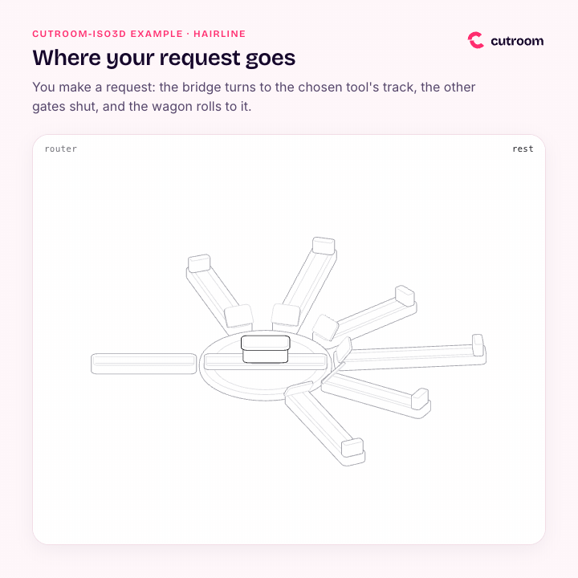

# Example: cutroom tool router (cutroom-iso3d / Hairline 0.5.1)

**Request:** "A figure explaining the routing of `cutroom`: a request arrives and is routed to the right tool among six outputs (diagram → Archify, math → ManimGX, video → HyperFrames, iso figure → Anatomy/Hairline, document → Docling, voice → Kokoro). Hairline style, single stroke, no drawn text labels: names go to the read-out."



| File | Description |
|---|---|
| [`out/hairline-router.html`](out/hairline-router.html) | The deliverable: dependency-free HTML. Hover over tracks, or press **play** |
| [`out/hairline-router-look.png`](out/hairline-router-look.png) | `look.mjs` verification sheet: rest, answer, 240 px thumbnails, dark and light themes, slider extremes |
| [`out/router.gif`](out/router.gif) | 8 s, 720 px, 12 fps, looping: the `?play=1` tour inside the cutroom brand frame |
| [`out/router.png`](out/router.png) | Static preview inside the brand frame, with the request routed to the math track |
| [`src/router.js`](src/router.js) | The figure (189 lines). The only editable source; kernel and bench come from the skill |
| [`src/frame.html`](src/frame.html) | Brand frame in cutroom Hot Signal, used to record the GIF and PNG previews |

## The concept

The `hairline-create` skill asks for 2 or 3 concepts and user selection. Without a user to choose (e.g. parallel crew agent), its rule is to keep the concept with the strongest rest pose:

- **Turntable** (chosen). A railway turntable with an entry line and six exit tracks (one for each cutroom tool: Archify, ManimGX, HyperFrames, Anatomy/Hairline, Docling, Kokoro), each with its gate and buffer stop. The pointer chooses a line: the bridge turns, other gates close in a wave, and the wagon (the request) rolls to the buffer stop. Read-out: `diagram → Archify`, `math → ManimGX`, etc. Tour: diagram, math, video, exit to rest.
- **Ladder siding.** A main track with six ladder sidings. The pointer chooses a siding, the switches up to it flip in sequence, and the wagon runs there.
- **Rotary selector.** A six-position rotary switch. The pointer chooses a position, the knob rotates to it, and the selected tool channel lights up.

The turntable won because rest already tells the story: an asymmetric star of tracks of varying lengths, with the request waiting illuminated at the center, legible even at 240 px thumbnail size. The ladder siding at rest looks like a plain comb (rejected by rule 05), with switchblades too small to read at thumbnail scale. The rotary selector is a symmetric icon with uniform positions.

## How it was made

```bash
J="examples/iso3d-router"
HL=~/.local/share/cutroom/upstream/hairline/skills/hairline-create

# 1. Figure written in src/router.js, verified with look.mjs
. ~/.local/share/cutroom/env.sh && cd "$J/src" && \
  node "$HL/look.mjs" router.js --answer=-62.99,-29.37,4.5 --edge=70,-60,4.5   # exit 0
cp hairline-router.html hairline-router-look.png ../out/

# 2. GIF and PNG recorded from the brand frame (src/frame.html loads ../out/hairline-router.html?play=1&theme=light)
record-html "$J/src/frame.html" "$J/out/router.gif" --wait 1.2 --seconds 8 --size 720x720 --width 720 --fps 12
record-html "$J/src/frame.html" "$J/work/router.mp4" --wait 1.2 --seconds 8 --size 720x720
ffmpeg -ss 4.2 -i "$J/work/router.mp4" -frames:v 1 "$J/out/router.png"
```

- Points for `--answer` and `--edge` use `=` (`--answer=-62.99,...`) to avoid Node `parseArgs` reading negative numbers as option flags.
- Tour duration is ~8.2 s. Recording begins 1.2 s after loading (before the first stop) and concludes when the wagon returns to rest, closing the loop without jumps.
- `look.mjs` exited with code 0: frame check passed (rest pose covers 43% of viewBox), read-out passed, clean console, no flickering, and answer motion moves 40% of ink at 240 px.

## How to open

```bash
open out/hairline-router.html      # Linux: xdg-open
```

Hover the pointer over the exit tracks. The read-out in the upper corner indicates where the request is routed, displaying `rest` when idle. To watch the automated tour, click **play** or open with `?play=1`. The slider adjusts the gate wave interval from 0 to 120 ms.

## Brand applied (cutroom Hot Signal)

Hairline is colorless single-line geometry (rule 04): no fills, shadows, or colors in the figure itself. The brand enters through text and the enclosing frame:

- In the figure: `means` and read-outs in English. Rest read-out is strictly `rest` (enforced by `look.mjs`).
- In the frame:
  - Surface: Blush Paper (`#FFF7FA`), text Night Plum (`#16072B`), muted text Mauve Grey (`#55466B`).
  - Eyebrow: Bricolage Grotesque 600, uppercase in Hot Signal (`#FF2D6F`).
  - Title: Bricolage Grotesque 600 in Night Plum (`#16072B`).
  - Body caption: Inter 400.
  - Figure viewport: 20 px border radius with cutroom shadow (`0 0 0 1px #F2DDE6, 0 6px 24px rgba(22, 7, 43, 0.06)`).
  - Wordmark logo: cutroom horizontal wordmark (`wordmark.svg`) positioned in the upper right.

## Notes & Limits

- The 6 exit tracks represent cutroom's core tools: `diagram → Archify`, `math → ManimGX`, `video → HyperFrames`, `iso → Anatomy/Hairline`, `document → Docling`, and `voice → Kokoro`.
- The tour visits the three topmost tracks (diagram, math, video) in sequence so paths between adjacent stops do not cross intervening tracks, avoiding flicker in the read-out.
- The `iso → Anatomy/Hairline` read-out is concise to avoid overlapping the figure name tag at 240 px thumbnail widths.
