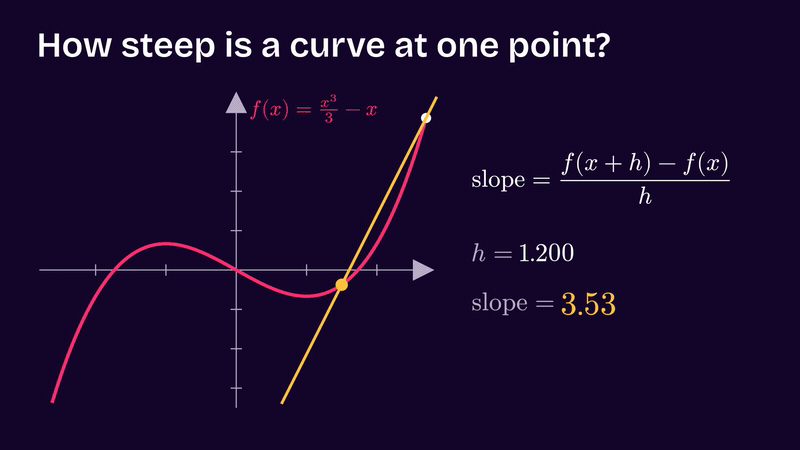

# Example: derivative of x³/3 − x (cutroom-math / ManimGX + Kokoro)

**Request:** "30 s ManimGX explainer of the derivative of x^3/3 - x with narration by the narrator profile (af_heart@0.95). Show the secant approaching the tangent, the limit h -> 0, and trace f'(x) = x^2 - 1."

<p align="center"></p>

[`out/derivative.mp4`](out/derivative.mp4) (29.93 s, 1920x1080 @ 18.21 fps, H.264 + AAC mono, 1.57 MB) · [`out/derivative.srt`](out/derivative.srt) (subtitles, 948 bytes) · [`out/sheet.png`](out/sheet.png) (contact sheet, 153 KB) · source in [`src/`](src)

| File | Description |
|---|---|
| [`out/derivative.mp4`](out/derivative.mp4) | Deliverable: 29.93 s explainer video with embedded audio and animated mathematical graphics (1.57 MB) |
| [`out/derivative.srt`](out/derivative.srt) | Timed subtitles with 15 synchronized cues (948 bytes) |
| [`out/preview.gif`](out/preview.gif) | Animated preview GIF of the tangent convergence and derivative trace (848 KB) |
| [`out/sheet.png`](out/sheet.png) | 4×3 contact sheet showing 12 keyframes with timestamps (153 KB) |
| [`out/derivative.storyboard.png`](out/derivative.storyboard.png) | ManimGX scene storyboard panel 1 (212 KB) |
| [`out/derivative.storyboard-2.png`](out/derivative.storyboard-2.png) | ManimGX scene storyboard panel 2 (71 KB) |
| [`src/SCRIPT.md`](src/SCRIPT.md) | Structured production script across 5 scenes with facts F1–F7 (3.4 KB) |
| [`src/scene.py`](src/scene.py) | ManimGX scene definition with automated voice synchronization (7.9 KB) |

## Mathematical script and scenes

The mathematical model is defined in [`src/scene.py`](src/scene.py) and asserted against the facts documented in [`src/SCRIPT.md`](src/SCRIPT.md):

- **Target function:** $f(x) = \frac{x^3}{3} - x$ (F1)
- **Measurement point:** $x = 1.5$ (F2)
- **Initial secant offset:** $h = 1.2$ (F3)
- **Secant slope:** $\frac{f(1.5 + 1.2) - f(1.5)}{1.2} = 3.53$ (F4)
- **Derivative at base point:** $f'(1.5) = 1.5^2 - 1 = 1.25$ (F5)
- **Derivative function:** $f'(x) = x^2 - 1$ (F7)
- **Stationary points:** $f'(x) = 0$ at $x = \pm 1$ (F6)

| Scene | Time | Speech | Visuals |
|---|---|---|---|
| 1. Hook | 0:00–0:04 | "A curve rises and falls. How steep is it at one single point?" | Coordinate axes and $f(x)$ drawn in Hot Signal; sunflower point marked at $x = 1.5$ |
| 2. Secant | 0:04–0:10 | "Take a second point, a small step h away. The line through both has a slope: rise over run." | Second point placed at $x + h$ ($h = 1.2$); secant line drawn with slope readout $3.53$ |
| 3. Limit | 0:10–0:17 | "Now shrink h toward zero. The line becomes the tangent. Its slope, one point two five, is the derivative." | $h$ animates down to $0.001$; secant line morphs into tangent; slope readout updates to $1.25$ |
| 4. Derivative graph | 0:17–0:25 | "Slide the point along the curve. Where it is flat, the slope is zero. All the slopes together draw f prime: x squared minus one." | Tangent travels along $f(x)$ from $x = -2.2$ to $2.2$; instantaneous slope values trace $f'(x) = x^2 - 1$ in soft pink; horizontal tangents marked at $x = \pm 1$ |
| 5. Close | 0:25–0:30 | "The derivative: the slope of the tangent, at every point." | Formula summary card with $f(x)$ and $f'(x)$; cutroom logo lockup |

## Commands

```bash
. ~/.local/share/cutroom/env.sh

# 1. Validate script facts
cutroom script check src/SCRIPT.md

# 2. Render ManimGX scene with automated voice synthesis
cd src
manimgx render scene.py Derivative -o ../out/derivative.mp4

# 3. Post-production inspections and previews
cutroom edit probe ../out/derivative.mp4
cutroom edit sheet ../out/derivative.mp4 -o ../out/sheet.png
cutroom edit gif ../out/derivative.mp4 -o ../out/preview.gif --fps 12 --width 800
```

## What to verify

- `cutroom edit probe out/derivative.mp4` verified properties:
  - Duration: 29.93 s
  - Resolution: 1920×1080
  - Frame rate: 18.21 fps
  - Video codec: H.264
  - Audio codec: AAC mono, 48,000 Hz
  - Loudness: -22.1 LUFS
- Mathematical assertions in `src/scene.py`:
  - `abs(df(1.5) - 1.25) < 1e-12` passed.
  - `abs(secant_slope(1.5, 1.2) - 3.53) < 0.005` passed.
- Subtitle synchrony: [`out/derivative.srt`](out/derivative.srt) contains 15 subtitle intervals aligned to word cues synthesized by Kokoro.
- Visual frame check: [`out/sheet.png`](out/sheet.png) confirms tangent lines and formulas stay within the axis boundary $[-2.8, 2.8] \times [-3.5, 4.5]$.

## How to open

```bash
# macOS
open out/derivative.mp4

# Linux
xdg-open out/derivative.mp4
```

## Brand applied

- **Active brand:** `cutroom` (loaded dynamically via `cutroom brand show --json`).
- **Canvas:** Night Plum `#16072B` background (`m.config.background_color`).
- **Typography:** Bricolage Grotesque SemiBold for titles (`F["display"]`), Inter for text and readouts (`F["text"]`).
- **Palette:**
  - Curve $f(x)$: Hot Signal `#FF2D6F` (stroke width 6)
  - Base dot and secant highlight: Sunflower `#FFC43D`
  - Derivative curve $f'(x)$: Soft Pink `#FF9BC0`
  - Grid axes and labels: Muted Mauve `#B9AEC9`
  - Closing logo: `logos/wordmark-deep.svg` on deep background
- **Narration:** saved profile `narrator` (`af_heart@0.95`, Kokoro US English).

## Limits

- ManimGX scene delivery renders at 18.21 fps.
- Tangent tracing is restricted to $x \in [-2.2, 2.2]$ so the tangent lines do not extend beyond the viewport bounds.
