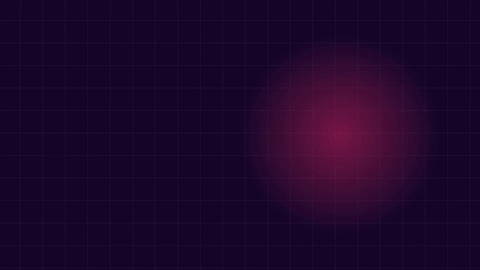

# Example: horizontal product intro in English (cutroom-motion / HyperFrames + Kokoro + earshot)

**Request:** a horizontal (16:9, 1920×1080) presentation of cutroom that never stops moving: modern transitions, zooms, a voice with natural pauses and a cadence that matches the picture, and a last frame that stays up a little longer.

<p align="center">
  <a href="out/intro.mp4"></a>
</p>
<p align="center">
  <a href="out/intro.mp4"><strong>▶ Watch &amp; listen (<code>out/intro.mp4</code> · 34.1 s · 1920×1080 horizontal · af_heart)</strong></a> ·
  <a href="../motion-intro/"><strong>Vertical version (9:16)</strong></a> ·
  <a href="../motion-intro-pt/"><strong>Versão em português do Brasil</strong></a>
</p>

[`out/intro.mp4`](out/intro.mp4) (34.1 s, 1920×1080 @ 30 fps, H.264 + AAC, -15 LUFS) · [`out/sheet.png`](out/sheet.png) (contact sheet) · [`out/sound-sheet.png`](out/sound-sheet.png) (earshot sound sheet) · [`out/last-frame.png`](out/last-frame.png) · [`out/intro.srt`](out/intro.srt) · [`src/cues.json`](src/cues.json) (96 cues, generated by [`src/make_cues.py`](src/make_cues.py)) · [`src/SCRIPT.md`](src/SCRIPT.md) · composition in [`src/intro/`](src/intro)

## How it is adapted to horizontal (16:9)

The script, speech, voice (`af_heart@1.0`), word-level timing, and 96 `earshot` sound cues are 100% identical to the vertical version ([`../motion-intro`](../motion-intro/)). The visual layout and scene compositions are restructured for the widescreen 1920×1080 canvas:

- **Scene 1 (Name & 15 Skills):** Widescreen split layout. The kinetic text ("A Swiss army knife / with 15 skills / for making media") rises on the left, while on the right, the 15 skill chips burst in a 360 px radius circle centered around the glowing counter ("15 media skills"). The exit zooms through the right-hand ring directly into the feed.
- **Scene 2 (Capability Feed):** 1400 px wide cards scrolling vertically through the 1080p frame (focal line at `top: 380px`). Each card's internal stage spans 1312 px, giving ample breathing room for the animated deck KPI, SVG network flow diagram, 3D exploded drawers, Docling PDF-to-Markdown scanner, derivative curve with tangent glide, multi-track audio playhead, brand palette swatches, 23 language chips, and 252 procedural sound spectrum bars.
- **Scene 3 (Six Agents):** 3 columns × 2 rows grid (`380×380 px` cards) framed inside a `1260×860 px` viewport on the right, while the left side features the giant "6 coding agents" typography. The GSAP camera tracks and zooms (`s: 1.6`) onto each agent as they are named, then pulls back to frame all six.
- **Scene 4 (Install):** Centered `1100 px` terminal window tilted in 3D perspective (`perspective: 1800px`) typing the install prompt, animating the progress bar, and displaying the 3 completion checkmarks, flanked by the headline above and the agent logos below.
- **Scene 5 (End Card):** Perfectly balanced centered end card on Hot Signal pink background, featuring the stacked contrast logo, the 3-line tagline ("Every piece / cut on your / machine."), and the rounded GitHub URL pill with skew sheen.

## One piece across formats

| | Horizontal (this folder) | Vertical ([`../motion-intro`](../motion-intro)) | Português do Brasil ([`../motion-intro-pt`](../motion-intro-pt)) |
|---|---|---|---|
| Resolution | **1920×1080 (16:9)** | 1080×1920 (9:16) | 1080×1920 (9:16) |
| Script | [`src/SCRIPT.md`](src/SCRIPT.md) | [`../motion-intro/src/SCRIPT.md`](../motion-intro/src/SCRIPT.md) | [`../motion-intro-pt/src/SCRIPT_PT.md`](../motion-intro-pt/src/SCRIPT_PT.md) |
| Voice | `af_heart@1.0` (en-us) | `af_heart@1.0` (en-us) | `pf_dora@1.0` (pt-br) |
| Duration | 34.1 s | 34.1 s | 34.4 s |
| Cues | 96 cues ([`src/cues.json`](src/cues.json)) | 96 cues | 96 cues |

## How to redo it

```bash
cd examples/motion-intro-horizontal
. ~/.local/share/cutroom/env.sh && export PYTHONPATH=../../harness
PY=~/.local/share/cutroom/bin/cutroom-python
$PY src/build.py         # writes src/intro/index.html
$PY src/make_cues.py     # generates src/cues.json
cd src/intro && hyperframes render --quality delivery --output ../../work/intro-horizontal-raw.mp4 && cd ../..
ffmpeg -i work/intro-horizontal-raw.mp4 -c:v libx264 -crf 25 -preset slow -pix_fmt yuv420p \
  -af loudnorm=I=-15:TP=-1.5:LRA=11 -ar 48000 -c:a aac -b:a 160k -movflags +faststart out/intro.mp4
```
