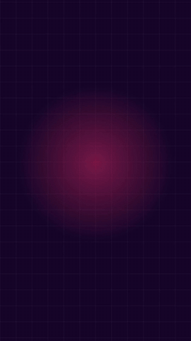

# Exemplo: Apresentação Vertical em Português com Narradora Feminina e Logo de Alto Contraste (cutroom-motion / HyperFrames + Kokoro + earshot)

**Solicitação:** "Segunda versão do vídeo de apresentação na resolução pra celular (9:16 vertical, 1080×1920) em português brasileiro, com cards adaptados para mobile, narração feminina em português (`pf_dora`, preset puro do Kokoro, sem áudio de referência), pronúncia técnica calibrada (incluindo `côuding`), símbolo do logo cutroom visível no último frame e 19 efeitos sonoros procedurais via earshot."

  

  <a href="out/intro-vertical-pt.mp4"><strong>▶ Assistir &amp; ouvir com áudio (<code>out/intro-vertical-pt.mp4</code> · 27.30 s · 1080×1920 vertical · Narradora pf_dora)</strong></a>

[`out/intro-vertical-pt.mp4`](out/intro-vertical-pt.mp4) (27.30 s, 1080x1920 @ 30.0 fps, H.264 + AAC stereo, 2.18 MB) · [`out/sheet.png`](out/sheet.png) (contact sheet vertical) · [`out/sound-sheet.png`](out/sound-sheet.png) (folha de áudio earshot) · [`out/last-frame.png`](out/last-frame.png) (frame final com logo corrigida) · [`out/intro-vertical-pt.srt`](out/intro-vertical-pt.srt) (legendas sincronizadas) · [`src/cues_pt.json`](src/cues_pt.json) (19 cues SFX procedurais) · fonte em [`src/intro/`](src/intro)

| Arquivo | Descrição |
|---|---|
| [`out/intro-vertical-pt.mp4`](out/intro-vertical-pt.mp4) | Entregável: vídeo vertical de 27.30 s narrado com a **voz feminina `pf_dora`** (preset puro, sem clonagem e sem esticar o áudio), pronúncia fonética calibrada, logo empilhado corrigido e 19 efeitos sonoros do `earshot` (2.18 MB) |
| [`out/last-frame.png`](out/last-frame.png) | Frame final da Cena 5 demonstrando o **símbolo icônico dos dois arcos** e o wordmark perfeitamente visíveis em Deep Plum (`#16072B`) sobre Hot Signal (`#FF2D6F`) |
| [`out/preview.gif`](out/preview.gif) | GIF animado de demonstração para visualização rápida no GitHub (280 KB) |
| [`out/sheet.png`](out/sheet.png) | Folha de contato 4×3 com 12 keyframes verticais ao longo das 5 cenas |
| [`out/sound-sheet.png`](out/sound-sheet.png) | Espectrograma e curva de sincronia audiovisual gerados via `earshot sheet` |
| [`out/intro-vertical-pt.srt`](out/intro-vertical-pt.srt) | Legendas em português sincronizadas cena a cena |
| [`src/SCRIPT_PT.md`](src/SCRIPT_PT.md) | Roteiro oficial de produção em português brasileiro com tabela fonética |
| [`src/speech_pt.txt`](src/speech_pt.txt) | Texto da fala extraído para síntese local |
| [`src/pronounce_pt.json`](src/pronounce_pt.json) | Dicionário fonético calibrado para português (incluindo `côuding`, `Câtrum`, `esquíls`, etc.) |
| [`src/cues_pt.json`](src/cues_pt.json) | 19 marcações de efeitos sonoros calibrados |
| [`src/intro/index.html`](src/intro/index.html) | Composição HyperFrames 1080×1920 adaptada com stack vertical e animações GSAP |

## Estrutura Vertical (1080×1920) para Mobile

1. **Cena 1: Decks, Diagramas, 3D e Extração (0:00 - 6.00s)**
   - Stack vertical com 4 cards de capacidades em Night Plum (`#16072B`): barras crescendo (`cutroom-deck`), pulso de sinal de arquitetura (`cutroom-diagram`), gaveta 3D isométrica (`cutroom-iso3d`) e scanner laser de PDF (`cutroom-extract`).
   - Narração: *"Cutroom. (pausa) Um canivete suíço, com quinze skills para criação de mídia."* (início em 0.40s, pausa de ~0.8s após o nome, término em 5.45s).
2. **Cena 2: Vídeos, Marcas, Voz e Som (6.00 - 13.50s)**
   - Fundo Blush Paper (`#FFF7FA`): curva matemática com tangente e leitura viva $f'(x) = 1.25$, timeline multi-faixa GSAP, amostras de paleta de marca e espectrograma dinâmico de 24 barras com 252 sons do `earshot`.
   - Narração: *"Vídeos de matemática e motion, marcas, voz local em vinte e três idiomas, e efeitos sonoros com earshot."* (início em 6.30s, término em 12.55s).
3. **Cena 3: 6 Agentes Coding Suportados (13.50 - 20.50s)**
   - Grid 2×3 com os 6 agentes de coding (Claude Code, Cursor, Codex, Antigravity, Gemini, Kiro) e os 3 pilares de execução: 100% Local, Pinos Travados e Equipes em Paralelo.
   - Narração: *"Compatível com seis agentes coding: Claude Code, Cursor, Codex, Antigravity, Gemini e Kiro."* (pronúncia calibrada `côuding`, início em 13.80s, término em 19.60s).
4. **Cena 4: Instalação Descomplicada (20.50 - 26.50s)**
   - Terminal de chat mobile digitando `Configure https://github.com/galvaowesley/cutroom` com checagens automáticas de sucesso.
   - Narração: *"Para instalar, envie o link do repositório ao seu agente coding, e deixe ele configurar o cutroom."* (início em 20.70s, término em 26.10s).
5. **Cena 5: Encerramento de Alto Contraste (26.50 - 28.00s)**
   - Tela cheia em Hot Signal (`#FF2D6F`) com **logo empilhado oficial (`stacked-contrast.svg`)**, destacando o símbolo dos dois arcos e o wordmark em Deep Plum (`#16072B`), slogan "Toda peça gerada na sua própria máquina" e URL do repositório, com kalimba final e sem sobreposição de fala.

## Calibração Fonética e Prosódia

| Termo | Fonética Aplicada | Justificativa |
|---|---|---|
| `coding` | `côuding` | Ditongo fechado padrão técnico ("côu-ding"), assertivo |
| `cutroom` | `Câtrum` | Evita a leitura errônea da vogal "u" em português |
| `skills` | `esquíls` | Evita o agrupamento consonantal "sk" estranho ao português |
| `motion` | `mouchon` | Pronúncia natural com som de chiado [ʃ] e nasal [õw̃] |
| `earshot` | `írchót` | Vogal aberta "ó" para manter a clareza de "shot" |
| `Claude Code` | `Clóud Coud` | Dicção fluida sem o "de" mudo no final |
| `Gemini` | `Djémini` | Africada inicial [dʒ] típica de nomes técnicos |
| `Antigravity` | `Antigráviti` | Prosódia proparoxítona natural |
| `Kiro` | `Quíro` | Fixação de som oclusivo [k] |

## Como a narração foi gerada

Cada bloco da fala é sintetizado separadamente com o preset `pf_dora` do Kokoro (`tts -f bloco.txt --voice pf_dora --speed 1.0 a 1.08`), sem perfil clonado e sem áudio de referência. Nenhum trecho passa por *time-stretch*: o ritmo vem da velocidade nativa do modelo (0,95 a 1,08) e de textos curtos o bastante para caber em cada cena. Os blocos entram nos tempos da cena com `adelay` (o nome "Cutroom" vem sozinho, com pausa de ~0,8 s antes do restante), são normalizados a -16 LUFS e misturados com o stem de efeitos do earshot.
