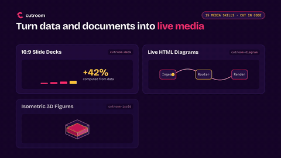

# Example: vertical product intro in English (cutroom-motion / HyperFrames + Kokoro + earshot)

**Request:** a vertical (9:16) presentation of cutroom that never stops moving: modern transitions, zooms, a voice with natural pauses and a cadence that matches the picture, and a last frame that stays up a little longer.

<p align="center">
  <a href="out/intro.mp4"></a>
</p>
<p align="center">
  <a href="out/intro.mp4"><strong>▶ Watch &amp; listen (<code>out/intro.mp4</code> · 34.1 s · 1080×1920 vertical · af_heart)</strong></a> ·
  <a href="../motion-intro-pt/"><strong>Versão em português do Brasil</strong></a>
</p>

[`out/intro.mp4`](out/intro.mp4) (34.1 s, 1080x1920 @ 30 fps, H.264 + AAC, 4.5 MB, -15 LUFS) · [`out/sheet.png`](out/sheet.png) (contact sheet) · [`out/sound-sheet.png`](out/sound-sheet.png) (earshot sound sheet) · [`out/last-frame.png`](out/last-frame.png) · [`out/intro.srt`](out/intro.srt) · [`src/cues.json`](src/cues.json) (96 cues, generated by [`src/make_cues.py`](src/make_cues.py)) · [`src/SCRIPT.md`](src/SCRIPT.md) · composition in [`src/intro/`](src/intro)

## How it is built

- **The picture follows the voice.** Seven short sentences at native speed (1.0), each synthesized in one go, with the punctuation breaths inside the sentence and pauses of 0.45 to 0.85 s between them (0.75 s after "cutroom"). Nothing is time-stretched. The time of each word comes from the audio ([`src/timing.py`](src/timing.py): silences measured, words spread by phoneme count) and the composition is generated from those times ([`src/build.py`](src/build.py) + [`src/intro.template.html`](src/intro.template.html)). If the speech changes, `timing.py`, `build.py` and `make_cues.py` redo times, animation and sounds together.
- **The animation never stops.** Overlapping scenes, a sliding grid, a feed of cards that keeps rising, a camera that closes in on each agent, a slow push on the chat and on the end card. The pauses of the voice are covered by the picture.
- **Transitions:** zoom through the icon ring and circle mask (1→2), whip pan with blur (2→3), vertical push with blur (3→4), pink circle mask (4→5).
- **Last frame held:** the speech ends at 30.6 s and the video runs to 34.1 s (3.5 s) with a slow push, a sheen on the URL and the logo on screen.
- **Motto:** "Every piece cut on your machine." (no comma, in the speech and on screen).

## One piece per language

Every language has its own script, speech, pronunciation dictionary, timing and cues, built by the same code:

| | English (this folder) | Português do Brasil ([`../motion-intro-pt`](../motion-intro-pt)) |
|---|---|---|
| Script | [`src/SCRIPT.md`](src/SCRIPT.md) | [`SCRIPT_PT.md`](../motion-intro-pt/src/SCRIPT_PT.md) |
| Speech | [`src/speech.txt`](src/speech.txt) | [`speech_pt.txt`](../motion-intro-pt/src/speech_pt.txt) |
| Pronunciation | [`src/pronounce.json`](src/pronounce.json) | [`pronounce_pt.json`](../motion-intro-pt/src/pronounce_pt.json) |
| Cues | [`src/cues.json`](src/cues.json) | [`cues_pt.json`](../motion-intro-pt/src/cues_pt.json) |
| Voice | `af_heart@1.0` (en-us) | `pf_dora@1.0` (pt-br) |

To make another language, copy a folder, translate the sentences in `src/timing.py` and `src/speech*.txt`, the text in `src/intro.template.html`, and the word indexes in `src/build.py` (they follow the sentence structure), then respell the names with `voice phonemes <voice> "<word>"`.

## The animation pattern in the harness

The pieces of the style (icon ring with zoom through, focus feed, camera on a grid, typing, counter, circle mask, whip pan, vertical push) are in [`harness/cutroom_motionkit.js`](../../harness/cutroom_motionkit.js) (copy in `src/intro/assets/`), and narration with natural pauses and per-word times in [`harness/cutroom_timing.py`](../../harness/cutroom_timing.py), for any language. The catalogue of patterns, the workflow and the checklist are in [`skills/cutroom-motion/references/dynamic-style.md`](../../skills/cutroom-motion/references/dynamic-style.md).

## How to redo it

```bash
cd examples/motion-intro
. ~/.local/share/cutroom/env.sh && export PYTHONPATH=../../harness
PY=~/.local/share/cutroom/bin/cutroom-python
$PY src/timing.py        # synthesizes work/en/v{n}.wav when missing, adds the pauses, measures the word times
$PY src/build.py         # writes src/intro/index.html
$PY src/make_cues.py     # sound cues at the same times
cutroom edit loudnorm work/en/narr_raw.wav -o src/intro/assets/narration.m4a --target -16
cutroom edit sfx work/en/narr_raw.wav --cues src/cues.json --stem src/intro/assets/sfx.wav --stem-only -o src/intro/assets/sfx.wav
cd src/intro && hyperframes render --quality delivery --output ../../work/intro-raw.mp4 && cd ../..
ffmpeg -i work/intro-raw.mp4 -c:v libx264 -crf 25 -preset slow -pix_fmt yuv420p -af loudnorm=I=-15:TP=-1.5:LRA=11 \
  -ar 48000 -c:a aac -b:a 160k -movflags +faststart out/intro.mp4
```

`src/intro/assets/sfx.wav` (10 MB) is generated and not tracked. Checks: `hyperframes snapshot`, `cutroom edit sheet` and `earshot sheet --cues` (93% of the 96 cues within 100 ms of the event). The voice was checked through its phonemes and by the sound sheet, not by ear.
