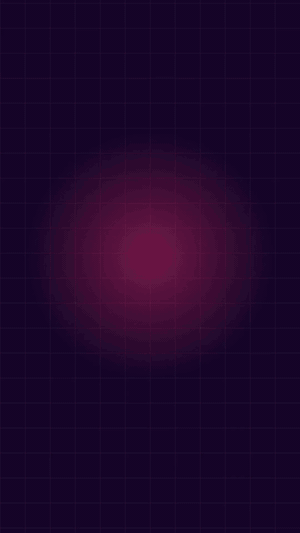

# Example: cutroom product intro (cutroom-motion / HyperFrames 0.8.183 + Kokoro + earshot)

**Request:** "29 s HyperFrames video with narration and strategic earshot sound effects presenting cutroom: animated visual representations of all 8 core capabilities, compatibility with 6 coding agents (Claude Code, Cursor, Codex, Antigravity, Gemini CLI, Kiro), local/pinned/parallel execution, and 1-step setup by handing the repository link to your coding agent."

<p align="center">
  <video src="out/intro.mp4" controls preload="metadata" poster="out/sheet.png" width="800">
    <a href="out/intro.mp4"></a>
  </video>
</p>
<p align="center">
  <a href="out/intro.mp4"><strong>▶ Watch &amp; listen with audio (<code>out/intro.mp4</code> · 29.0 s · 1080p)</strong></a>
</p>

[`out/intro.mp4`](out/intro.mp4) (29.0 s, 1920x1080 @ 30.0 fps, H.264 + AAC stereo, 2.89 MB) · [`out/sheet.png`](out/sheet.png) (contact sheet) · [`out/sound-sheet.png`](out/sound-sheet.png) (earshot sound sheet) · [`src/cues.json`](src/cues.json) (19 earshot SFX cues) · source in [`src/intro/`](src/intro) · narration in [`src/intro/assets/narration.m4a`](src/intro/assets/narration.m4a) (27.5 s)

| File | Description |
|---|---|
| [`out/intro.mp4`](out/intro.mp4) | Deliverable: 29.0 s product video with synchronized voiceover and 19 strategic `earshot` sound cues (2.89 MB) |
| [`out/sheet.png`](out/sheet.png) | 4×3 contact sheet showing 12 keyframes across all 5 scenes |
| [`out/sound-sheet.png`](out/sound-sheet.png) | `earshot sheet` audio-visual contact sheet showing spectrogram, waveform, loudness, and 19 cue sync markers |
| [`src/SCRIPT.md`](src/SCRIPT.md) | Structured production script with 5 scenes and verified facts F1–F4 |
| [`src/speech.txt`](src/speech.txt) | Raw narration text across 5 paragraph blocks |
| [`src/pronounce.json`](src/pronounce.json) | Phonetic dictionary for English synthesis: `"Kiro": "Kee-ro"`, `"earshot": "ear-shot"` |
| [`src/cues.json`](src/cues.json) | 19 sample-accurate `earshot` sound cues (`tick.snap`, `ping.glass`, `whoosh.soft`, `marker.chalk`, `lock.snap`, `chord.warm`, `pop.bubble`, `tick.key`, `chime.oct`, `chime.fifth`) |
| [`src/intro/index.html`](src/intro/index.html) | HyperFrames HTML composition with animated capability miniatures and GSAP timelines |
| [`src/intro/hyperframes.json`](src/intro/hyperframes.json) | HyperFrames project configuration |
| [`src/intro/package.json`](src/intro/package.json) | Node package definition |
| [`src/intro/meta.json`](src/intro/meta.json) | Composition metadata |
| [`src/intro/assets/narration.m4a`](src/intro/assets/narration.m4a) | Synthesized voiceover track (27.5 s, AAC mono, -16.5 LUFS) |
| [`src/intro/assets/brand/`](src/intro/assets/brand) | Local copy of brand tokens.css, fonts.css, SVG icons, logos, and TTF font files |

## Script and verified facts

Every number and claim in the video is drawn directly from repository code and configuration:

- **F1 (Skill library):** 15 built-in media skills in the `skills/` directory (`cutroom-init`, `cutroom-studio`, `cutroom-script`, `cutroom-extract`, `cutroom-deck`, `cutroom-diagram`, `cutroom-iso3d`, `cutroom-math`, `cutroom-motion`, `cutroom-voice`, `cutroom-sound`, `cutroom-edit`, `cutroom-graphic`, `cutroom-brand`, `cutroom-logo`).
- **F2 (Cloning languages):** 23 languages supported locally by Chatterbox voice cloning in `cutroom_voice.py`.
- **F3 (Procedural sound bank):** 252 procedural and acoustically fitted sound effects in `earshot` (`cutroom-sound`).
- **F4 (Supported coding agents):** 6 coding agents supported by `install.py` and `cutroom crew`: Claude Code, Cursor, Codex, Antigravity, Gemini CLI, and Kiro.

| Scene | Time | Speech | Visuals & Sound Cues (`src/cues.json`) |
|---|---|---|---|
| 1. Capabilities I | 0:00–0:06.45 | "cutroom turns data and documents into live media: slide decks, interactive diagrams, isometric 3D figures, and structured extraction." | Night Plum (`#16072B`); 2×2 animated capability showcase: KPI bars rising to `+42%` (`ping.glass`), packet routing across Bezier nodes (`whoosh.soft`), isometric 3D drawer lifting out (`lock.snap`), and PDF laser scan extracting a Markdown table (`pop.bubble`) |
| 2. Capabilities II | 0:06.45–0:13.32 | "It renders math explainers and motion graphics, builds brands and vector logos, clones voices locally, and layers procedural sound effects with earshot." | Blush Paper (`#FFF7FA`); 2×2 animated showcase: live cubic curve + sweeping tangent slope (`marker.chalk`), multi-track GSAP/Voice/SFX timeline with moving playhead (`lock.snap`), flipping brand palette swatches (`chord.warm`), and pulsing 20-bar spectrogram (`ping.glass`) |
| 3. Six Agents | 0:13.32–0:22.21 | "Everything runs locally and pinned across Claude Code, Cursor, Codex, Antigravity, Gemini CLI, and Kiro—even in parallel crews." | Night Plum (`#16072B`); 6 coding agent cards stagger in (`pop.bubble`, `tick.focus`), followed by 3 architecture pillars: `Local`, `Pinned`, and `Parallel` (`chord.warm`) |
| 4. One-Step Setup | 0:22.21–0:27.35 | "To install, just hand the repository link to your coding agent and let it configure everything." | Agent chat prompt types `Configure https://github.com/galvaowesley/cutroom` (`tick.key`) and reveals two instant green checkmarks (`chime.oct`) |
| 5. End Card | 0:27.35–0:29.00 | *(musical tail)* | Hot Signal (`#FF2D6F`) full-bleed end card with `wordmark-light.svg`, tagline, and repo URL (`chime.fifth`) |

## Pronunciation dictionary

[`src/pronounce.json`](src/pronounce.json) provides phonetic substitutions for Kokoro US English synthesis:

| Written | Pronounced |
|---|---|
| `Kiro` | `Kee-ro` |
| `earshot` | `ear-shot` |

## Commands

```bash
. ~/.local/share/cutroom/env.sh

# 1. Validate script facts and export speech + pronunciation dictionary
cutroom script check src/SCRIPT.md
cutroom script speech src/SCRIPT.md -o src/speech.txt
cutroom script pronounce src/SCRIPT.md -o src/pronounce.json

# 2. Synthesize English voiceover with Kokoro and normalize to -16 LUFS
tts -f src/speech.txt -o src/intro/assets/narration-raw.m4a --voice af_heart --speed 0.95 --pronounce src/pronounce.json
cutroom edit loudnorm src/intro/assets/narration-raw.m4a -o src/intro/assets/narration.m4a --target -16

# 3. Check and render video composition with HyperFrames
cd src/intro
hyperframes lint
hyperframes check
hyperframes render --quality delivery --output ../../work/intro-raw.mp4
cd ../..

# 4. Mix strategic earshot sound cues and generate visual + audio sheets
cutroom edit sfx work/intro-raw.mp4 --cues src/cues.json -o out/intro.mp4
cutroom edit probe out/intro.mp4
cutroom edit sheet out/intro.mp4 -o out/sheet.png
earshot sheet out/intro.mp4 --cues src/cues.json -o out/sound-sheet.png
```

## What to verify

- `cutroom edit probe out/intro.mp4` verified properties:
  - Duration: 29.00 s
  - Resolution: 1920×1080
  - Frame rate: 30.0 fps
  - Video codec: H.264
  - Audio codec: AAC stereo (2 channels), 48,000 Hz
  - Loudness: -13.5 LUFS
- `hyperframes lint` passed with 0 errors and 0 warnings.
- `hyperframes check` passed with 0 layout/motion/runtime issues and 61/61 WCAG AA contrast checks passed.
- `earshot sheet` verified 19/19 cues hit with 0 missed hits and 100% of scene cuts aligned within 100 ms.

## How to open

```bash
# macOS
open out/intro.mp4

# Linux
xdg-open out/intro.mp4
```

## Brand applied

- **Palette transitions:** solid background cuts between Night Plum `#16072B`, Blush Paper `#FFF7FA`, and Hot Signal `#FF2D6F`.
- **Typography:** Bricolage Grotesque (700 and 600 weight) for display typography, eyebrows, and agent cards; Inter for body copy; JetBrains Mono NL for paths, readouts, and agent prompt.
- **Motion & Sound:** custom GSAP cubic-bezier easing (`cubic-bezier(0.2, 0.8, 0.2, 1)`) paired with 19 sample-accurate `earshot` cues (`src/cues.json`).
